## AWS Integration & Messaging

## SQS, SNS & Kinesis

## Section Introduction

When we start deploying multiple applications, they will inevitably need to communicate with one another

There are two patterns of application communication

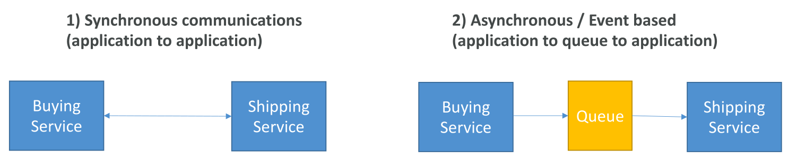

Synchronous between applications can be problematic if there are sudden spikes of traffic

What if you need to suddenly encode 1000 videos but usually it’s 10?

In that case, it’s better to decouple your applications,
 - using SQS: queue model
 - using SNS: pub/sub model
 - using Kinesis: real-time streaming model

These services can scale independently from our application!

## Amazon SQS What’s a queue?

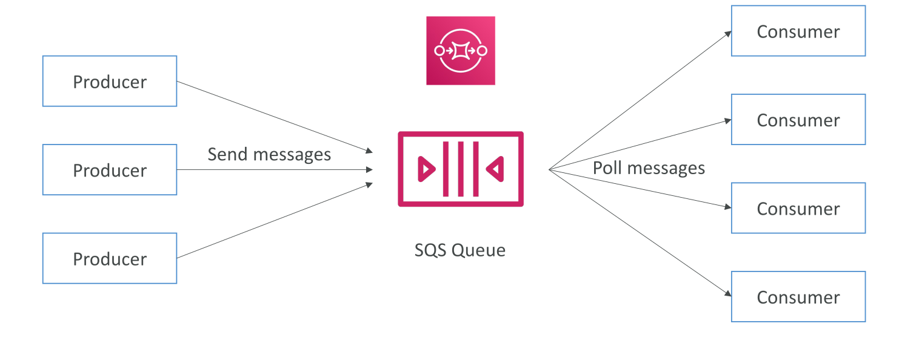

## Amazon SQS – Standard Queue

Oldest offering (over 10 years old)

Fully managed service, used to decouple applications

Attributes:
 - Unlimited throughput, unlimited number of messages in queue
 - Default retention of messages: 4 days, maximum of 14 days
 - Low latency (<10 ms on publish and receive)
 - Limitation of 1,024 KB per message sent

Can have duplicate messages (at least once delivery, occasionally)

Can have out of order messages (best effort ordering)

## SQS – Producing Messages

Produced to SQS using the SDK (SendMessage API)

The message is persisted in SQS until a consumer deletes it

Message retention: default 4 days, up to 14 days

Example: send an order to be processed
 - Order id
 - Customer id
 - Any attributes you want

SQS standard: unlimited throughput

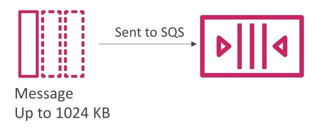

## SQS – Consuming Messages

• Consumers (running on EC2 instances, servers, or AWS Lambda)…

• Poll SQS for messages (receive up to 10 messages at a time)

• Process the messages (example: insert the message into an RDS database)

• Delete the messages using the DeleteMessage API

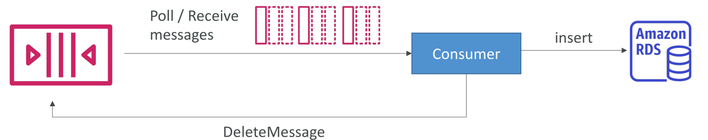

## SQS – Multiple EC2 Instances Consumers

Consumers receive and process messages in parallel

At least once delivery

Best-effort message ordering

Consumers delete messages after processing them

We can scale consumers horizontally to improve throughput of processing

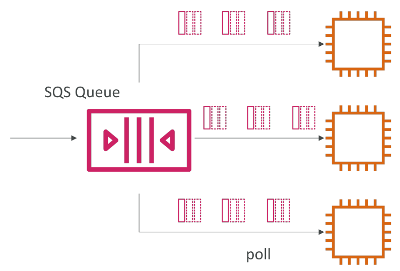

## SQS with Auto Scaling Group (ASG)

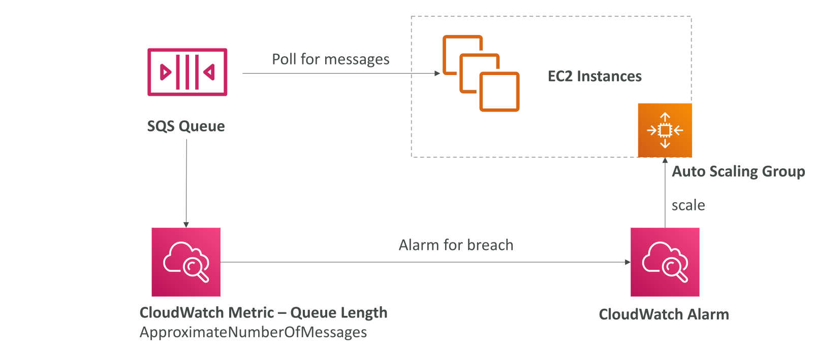

## SQS to decouple between application tiers

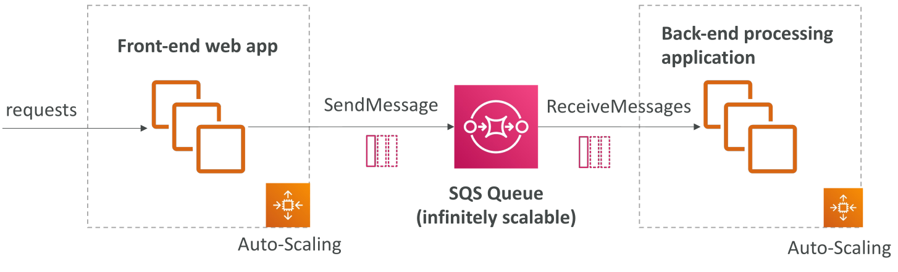

## Amazon SQS - Security

Encryption:
 - In-flight encryption using HTTPS API
 - At-rest encryption using KMS keys
 - Client-side encryption if the client wants to perform encryption/decryption itself

Access Controls: IAM policies to regulate access to the SQS API

SQS Access Policies (similar to S3 bucket policies)
 - Useful for cross-account access to SQS queues
 - Useful for allowing other services (SNS, S3…) to write to an SQS queue

 ## SQS – Message Visibility Timeout - Exam important

After a message is polled by a consumer, it becomes invisible to other consumers

By default, the “message visibility timeout” is 30 seconds

That means the message has 30 seconds to be processed

After the message visibility timeout is over, the message is “visible” in SQS

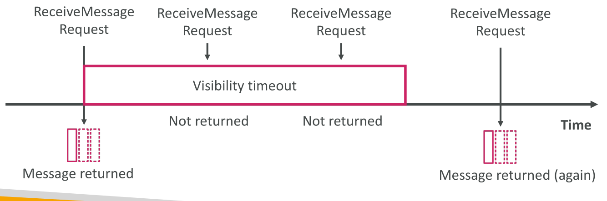

## SQS – Message Visibility Timeout -Exam important

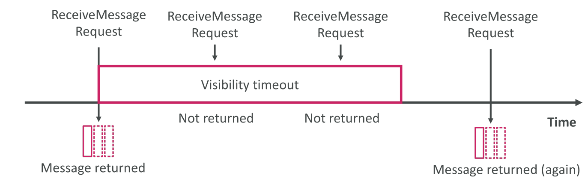

If a message is not processed within the visibility timeout, it will be processed twice

A consumer could call the ChangeMessageVisibility API to get more time

If visibility timeout is high (hours), and consumer crashes, re-processing will take time

If visibility timeout is too low (seconds), we may get duplicates

## Amazon SQS - Long Polling

When a consumer requests messages from the queue, it can optionally “wait” for messages to arrive if there are none in the queue

This is called Long Polling LongPolling decreases the number of API calls made to SQS while increasing the efficiency and reducing latency of your application

The wait time can be between 1 sec to 20 sec (20 sec preferable)

Long Polling is preferable to Short Polling

Long polling can be enabled at the queue level or at the API level using WaitTimeSeconds

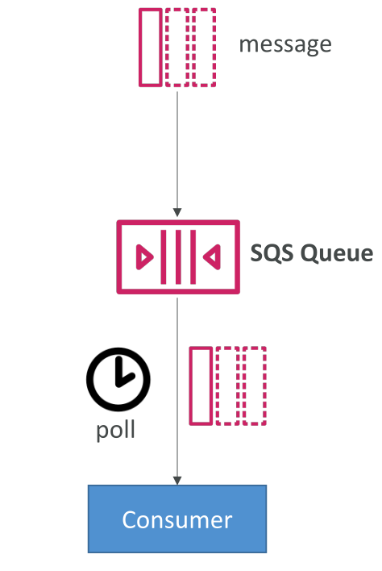

## Amazon SQS – FIFO Queue

FIFO = First In First Out (ordering of messages in the queue)

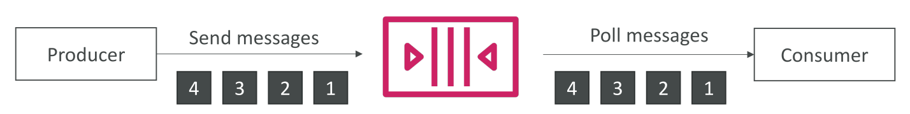

Limited throughput: 300 msg/s without batching, 3000 msg/s with

Exactly-once send capability (by removing duplicates using Deduplication ID)

Messages are processed in order by the consumer

Ordering by Message Group ID (all messages in the same group are ordered) – mandatory parameter

## SQS with Auto Scaling Group (ASG)

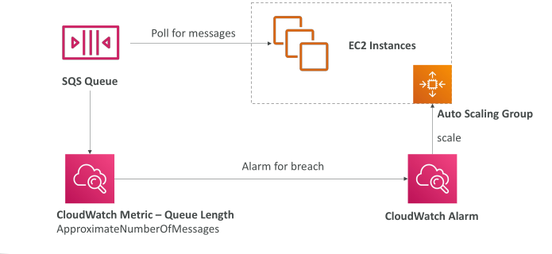

## If the load is too big, some transactions may be lost - Exam important

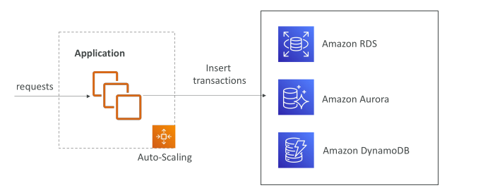

## SQS as a buffer to database writes - Exam important

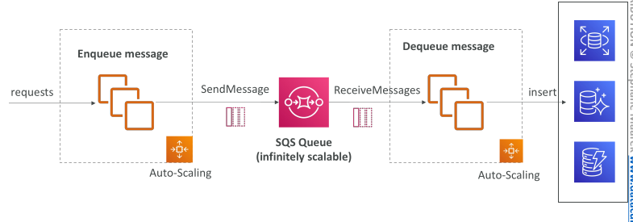

Because sqs queue is indefinately scalable you can use sqs queue as a buffer, instead of writing directly into your database, the application is going to write your transaction request of transaction into your sqs queue. You can create another autoscaling group to dequeue messages or receive the messages and store them to the databases. When a messages is known to be inserted it is deleted from the queue.Therefore we use sqs as a buffer and we guarantee every single transaction is going to be written into your database

# Does the SQS Message Carry the Data to Be Inserted into the Database?

**Yes.** The message body in SQS carries the actual transaction data (typically as JSON) that is meant to be inserted into the database.

## How It Works

1. **Producer** (your app) sends a message to SQS whose body contains the transaction details, e.g.:
   ```json
   {"txn_id": "123", "user": "A", "amount": 50}
   ```
2. **SQS stores** the message durably (up to 256 KB per message). For larger payloads, store the data in S3 and put only a pointer in the message.
3. **Consumer** (the autoscaling group of workers) polls the queue, receives the message, and reads the data from the body.
4. The consumer **inserts that data into the database**.
5. Only after a successful insert does the consumer **delete the message** from the queue.

## Why This Guarantees No Data Loss

When a consumer receives a message, SQS doesn't remove it. It just hides it for the **visibility timeout**. If the consumer crashes before inserting and deleting, the message becomes visible again and another worker picks it up. That's why deletion happens only after a confirmed write.

## Caveat: At-Least-Once Delivery

Standard SQS delivers messages **at least once**, so a message may occasionally be delivered twice. Make your database writes **idempotent** (e.g., use a unique transaction ID as a key) so duplicates don't create duplicate records.


## SQS to decouple between application tiers - Exam important

Decouple applications into service oriented apps with sqs queue

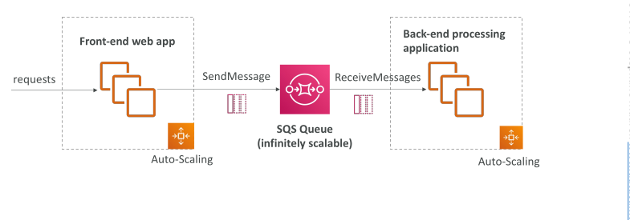

