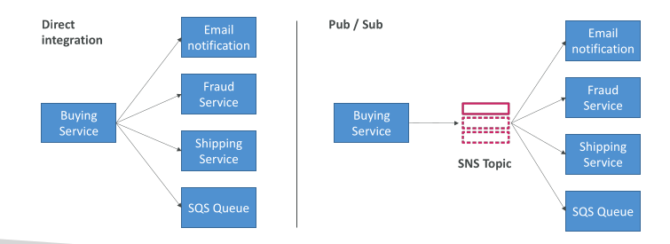
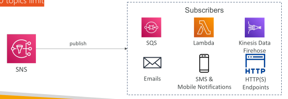
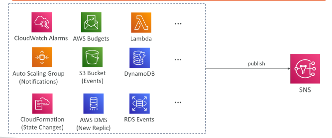
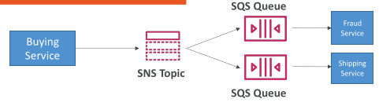
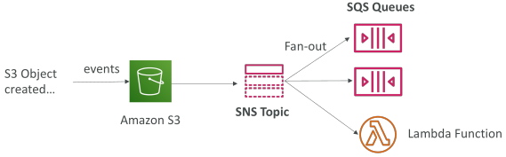
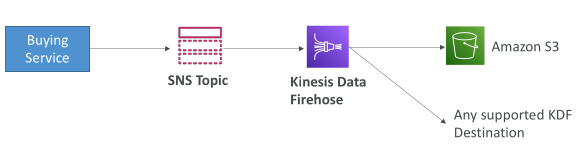
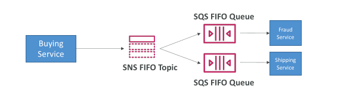
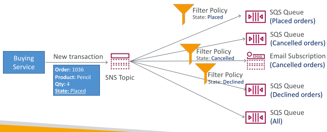

## Amazon SNS

• What if you want to send one message to many receivers?




## Amazon SNS

• The “event producer” only sends message to one SNS topic
• As many “event receivers” (subscriptions) as we want to listen to the SNS topic notifications
• Each subscriber to the topic will get all the messages (note: new feature to filter messages)
• Up to 12,500,000 subscriptions per topic
• 100,000 topics limit



## SNS integrates with a lot of AWS services

• Many AWS services can send data directly to SNS for notifications




## Amazon SNS – How to publish

Topic Publish (using the SDK)
 - Create a topic
 - Create a subscription (or many)
 - Publish to the topic
    
Direct Publish (for mobile apps SDK)
 - Create a platform application
 - Create a platform endpoint
 - Publish to the platform endpoint
 - Works with Google GCM, Apple APNS, Amazon ADM…

Scenario Example: Amazon SNS Direct Publish

In a food delivery app, when a driver picks up an order, only that customer's phone should receive the push notification "Your order is on the way!", so the backend uses Direct Publish instead of a topic: during setup it creates a platform application for each mobile platform (APNS for iOS, GCM/FCM for Android), and when the customer installs the app and logs in, the app sends its device token to the backend, which creates a platform endpoint and saves the resulting EndpointArn with the user's profile; later, when the driver picks up the order, the backend looks up that customer's EndpointArn and calls sns.publish(TargetArn=endpoint_arn, ...), and SNS delivers the message through APNS or GCM to that one device, whereas Topic Publish would be the right choice only if the same event, such as "order placed," had to fan out to many subscribers like inventory, email, and analytics.


## Amazon SNS – Security

Encryption
 - In-flight encryption using HTTPS API
 - At-rest encryption using KMS keys
 - Client-side encryption if the client wants to perform encryption/decryption itself

Access Controls: IAM policies to regulate access to the SNS API

SNS Access Policies (similar to S3 bucket policies)
 - Useful for cross-account access to SNS topics
 - Useful for allowing other services ( S3…) to write to an SNS topic

## SNS + SQS: Fan Out - Exam important



## Application: S3 Events to multiple queues - Exam important

For the same combination of: event type (e.g. object create) and prefix (e.g. images/) you can only have one S3 Event rule

If you want to send the same S3 event to many SQS queues, use fan-out

S3 allows only one event rule for the same combination of event type (e.g., object create) and prefix (e.g., images/), so you can't point that one rule at several SQS queues directly; instead, send the S3 event to a single SNS topic and subscribe multiple SQS queues to it (fan-out), so every queue receives its own copy of the same event, for example one queue for thumbnail creation, one for analytics, and one for auditing.



## Application: SNS to Amazon S3 through Kinesis Data Firehose - Exam important

• SNS can send to Kinesis and therefore we can have the following
solutions architecture:



## Amazon SNS – FIFO Topic - Exam important

• FIFO = First In First Out (ordering of messages in the topic)


Similar features as SQS FIFO:
 - Ordering by Message Group ID (all messages in the same group are ordered)
 - Deduplication using a Deduplication ID or Content Based Deduplication

Can have SQS Standard and FIFO queues as subscribers

Limited throughput (same throughput as SQS FIFO)

# SNS FIFO Topic: Ordering and Deduplication

## Ordering (Message Group ID)

Messages that share the same **Message Group ID** are delivered in the exact order they were published; messages in different groups can be processed independently.

## Deduplication (Deduplication ID or Content-Based)

If the same message is published more than once within the 5-minute deduplication window, SNS accepts it but delivers only one copy. You either supply a **Deduplication ID** yourself or enable **content-based deduplication**, where SNS uses a hash of the message body as the ID.

## Very Brief Example

An order system publishes to an SNS FIFO topic using the order number as the Message Group ID:

```python
sns.publish(
    TopicArn="arn:aws:sns:us-east-1:123456789012:orders.fifo",
    Message="Order 101: PAID",
    MessageGroupId="order-101",
    MessageDeduplicationId="order-101-paid"
)
```

- **Ordering:** "Order 101: CREATED" then "PAID" then "SHIPPED" all use group `order-101`, so subscribers always see them in that sequence.
- **Deduplication:** if the app retries and publishes "Order 101: PAID" twice with the same Deduplication ID, subscribers receive it only once.

Subscribers can be SQS Standard or FIFO queues, and throughput is limited to the same level as SQS FIFO.

## SNS FIFO + SQS FIFO: Fan Out - Exam important

• In case you need fan out + ordering + deduplication



## SNS – Message Filtering - Exam important

• JSON policy used to filter messages sent to SNS topic’s subscriptions

• If a subscription doesn’t have a filter policy, it receives every message




