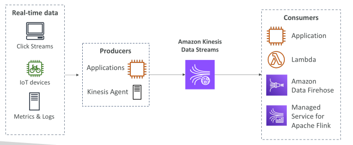
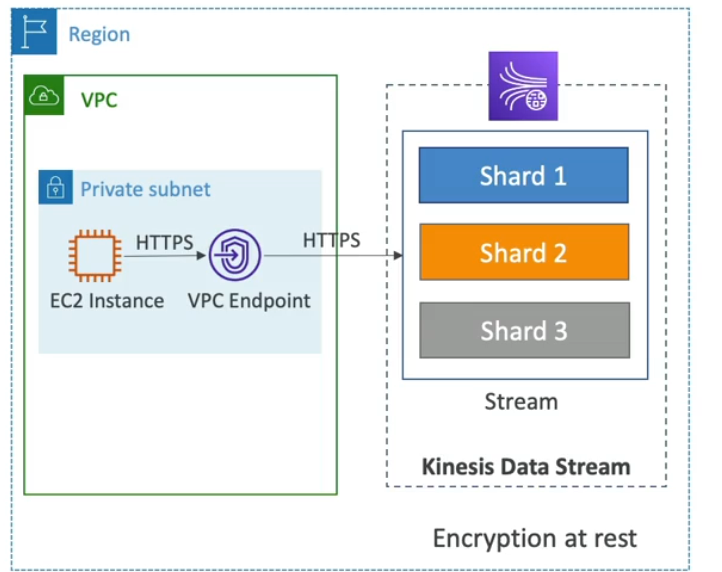
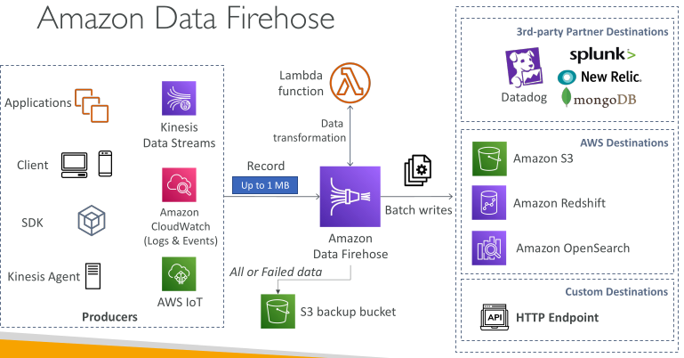

## Kinesis Overview - This whole topic is exam important

Makes it easy to collect, process and analyze streaming data in real-time.

Ingest real-time data such as Application logs, Metrics, Website clickstreams, IoT telemetry data..

 - Kinesis Data streams - capture, process and store data streams
 - Kinesis Data firehose - load data streams into AWS data stores
 - Kinesis Data analytics - analyze data streams with SQL or Apache flink
 - Kinesis Video Streams - capture, process and store video streams

## Amazon Kinesis Data Streams 

Kinesis Data streams is a way to stream big data in your systems.

It is made of muliple shards and shards are numbered 1 to n. And you have to provision shards ahead of time. Data is going to be split between the shards and the shards are going to be defining your stream capacity in terms onf ingestion and consumption rates.

Producers - They send data into kinesis data streams. They could be applications, desktop or mobile clients, they could be leeraging the aws sdk at a very low level or the kinesis producer library at a higher level or the kinesis agent that lives in a server to stream application logs into Kinesis data streams.All these producers rely on the sdk ata a very low level

The producers do the same thing which is producing a record. A record is made of a partition key, data blob that is upto 1 megabytes

The partition key will determine in which shard the ecord will go to.

Blob is the data value itself

Producers can send data at the rate of 1 megabytes per second or a thousand messages per second per shard.
6 shards = 6mbs/sec or 6000 msgs per sec

KDS have consumers
Consumers - Can be apps that rely on the sdk or on high levele the Kinesis cliet libraries, lambda functions, kinesis data firehose or kinesis data analytics.

When the consumer receives a record it receives the partition key, a sequence number ( which represents where the record was in the shard) and the data blob.

We have different consumption modes for kinesis data streams
 - 2mbps of throughput shared for all the consumers per shard
 - 2mbps per shard per consumer i enhanced consumer mode is enabled

• Collect and store streaming data in real-time

## Kinesis Data Streams

• Retention between 1 day to 365 days

• Ability to reprocess (replay) data by consumers

• Data can’t be deleted from Kinesis (until it expires)

• Data up to 10MiB (typical use case is lot of “small” real-time data)

• Data ordering guarantee for data with the same “Partition ID”

• At-rest KMS encryption, in-flight HTTPS encryption

• Kinesis Producer Library (KPL) to write an optimized producer application

• Kinesis Client Library (KCL) to write an optimized consumer application

## Kinesis Data Streams – Capacity Modes

Provisioned mode:
 - Choose number of shards
 - Each shard gets 1MB/s in (or 1000 records per second)
 - Each shard gets 2MB/s out
 - Scale manually to increase or decrease the number of shards
 - You pay per shard provisioned per hour

On-demand mode:
 - No need to provision or manage the capacity
 - Default capacity provisioned (4 MB/s in or 4000 records per second)
 - Scales automatically based on observed throughput peak during the last 30 days
 - Pay per stream per hour & data in/out per GB

## Kinesis Data streams security

Control access/ authorization using IAM policies

Encryption in flight using HTTPS endpoints

Encryption at rest using KMS

You can implement encryption/decryption of data on client side(harder)

VPC endpoints available for kinesis to access within VPC 

Monitor API calls using cloudtrail

 ## Amazon Data Firehose

Kinesis data firehose takes data from sources(producers), the common is kinesis data streams. These producers send records to firehose and firehose can optionally choose to transform the data using a lambda function the it can be written in batches to destinations

There are 3 kinds of destinations 
1. AWS destinations
   - s3
   - redshift
   - opensearch

2. 3rd party partner destiantions
   - Datadog
   - Mongodb
   - Splunk

3. HTTP endpoint

 

## Amazon Data Firehose

Note: used to be called “Kinesis Data Firehose”

Fully Managed Service, no administration,automatic scaling serverless
 - Amazon Redshift / Amazon S3 / Amazon OpenSearch Service
 - 3rd party: Splunk / MongoDB / Datadog / NewRelic / …
 - Custom HTTP Endpoint

Pay for data through firehose

Automatic scaling, serverless, pay for what you use

Near Real-Time with buffering capability based on size / time
 - 60 second latency minimum for non full batches
 - Or minimum 1mb of data at a time

Supports CSV, JSON, Parquet, Avro, Raw Text, Binary data

Conversions to Parquet / ORC, compressions with gzip / snappy

Custom data transformations using AWS Lambda (ex: CSV to JSON)

## Kinesis Data Streams vs Amazon Data Firehose - Exam important

Kinesis Data Streams
 - Streaming service for ingest at scale
 - You write Producer & Consumer code
 - Real-time
 - Manage scaling (shard splitting / merging)
 - Provisioned / On-Demand mode
 - Data storage up to 365 days
 - Suport Replay Capability

Amazon Data firehose
 - Load streaming data into S3 / Redshift / OpenSearch / 3rd party / custom HTTP
 - Fully managed
 - Near real-time (buffer time min 60 sec.)
 - Automatic scaling
 - No data storage
 - Doesn’t support replay capability