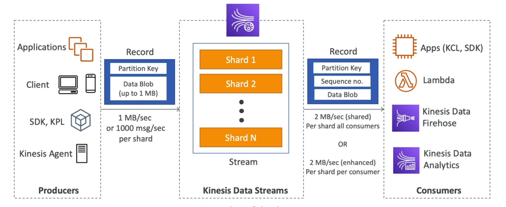
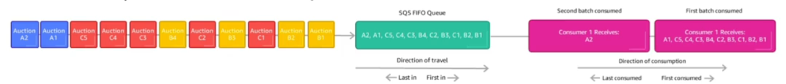
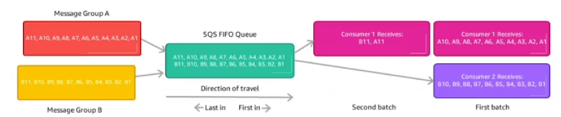
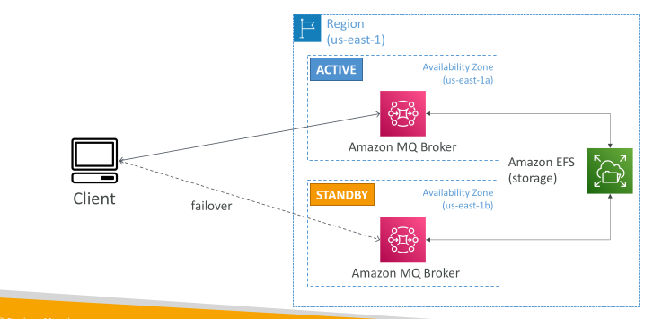

 ## Ordering data into kinesis - EXAM IMPORTANT

Imagine you have 100 trucks (truck_1, truck_2,...,truck_100) on the road sending their GPS positions into AWS.

You want to consume the data in order for each truck so that you can track their movement accurately

How should you send that data into Kinesis?

Answer: send using a 'Partition Key' value of the "truck_id"
The same key will always go to the same shard

## Ordering data into sqs - EXAM IMPORTANT

For sqs standard ther is no ordering

For sqs fifo if you don't use a GroupID, messsages are consumed in the order they are sent, with only one consumer.

You want to scale the number of consumers but you want messaed to be grouped when they are related to each other

Then you use a group id (similar to partition key in kinesis)

## Kinesis vs Sqs ordering - EXAM IMPORTANT

Let's assume 100 trucks, 5 kinesis shards, 1 sqs fifo

Kinesis data streams
 - On average you'll have 20 trucks per shard
 - Trucks will have their data ordered within each shard
 - The maximum amount of consumers in parallel we can have is 5
 - Can receive up to 5mb/s of data

SQS FIFO
 - You only have one sqs fifo queue
 - You will have 100 group id
 - You can have upto 100 consumers (due to the group id)
 - You have upto 300 messaged per second(or 3000 if using batching)

 ## SQS vs SNS vs Kinesis

 | SQS | SNS | Kinesis |
|---|---|---|
| Consumer "pull data" | Push data to many subscribers | Standard: pull data |
| Data is deleted after being consumed | Up to 12,500,000 subscribers | 2 MB per shard |
| Can have as many workers (consumers) as we want | Data is not persisted (lost if not delivered) | Enhanced-fan out: push data |
| No need to provision throughput | Pub/Sub | 2 MB per shard per consumer |
| Ordering guarantees only on FIFO queues | Up to 100,000 topics | Possibility to replay data |
| Individual message delay capability | No need to provision throughput | Meant for real-time big data, analytics and ETL |
| | Integrates with SQS for fan-out architecture pattern | Ordering at the shard level |
| | FIFO capability for SQS FIFO | Data expires after X days |
| | | Provisioned mode or on-demand capacity mode |

## Amazon MQ

SQS, SNS are “cloud-native” services: proprietary protocols from AWS

Traditional applications running from on-premises may use open protocols such as: MQTT, AMQP, STOMP, Openwire, WSS

When migrating to the cloud, instead of re-engineering the application to use SQS and SNS, we can use Amazon MQ

Amazon MQ is a managed message broker service for
 - RabbitMQ
 - ActiveMQ

Amazon MQ doesn’t “scale” as much as SQS / SNS

Amazon MQ runs on servers, can run in Multi-AZ with failover

Amazon MQ has both queue feature (~SQS) and topic features (~SNS)

## Amazon MQ – High Availability

