## Serverless Overview

## What’s serverless?

• Serverless is a new paradigm in which the developers don’t have to manage servers anymore…

• They just deploy code

• They just deploy… functions !

• Initially... Serverless == FaaS (Function as a Service)

• Serverless was pioneered by AWS Lambda but now also includes anything that’s managed: “databases, messaging, storage, etc.”

• Serverless does not mean there are no servers… it means you just don’t manage / provision / see them

## Serverless in AWS
• AWS Lambda

• DynamoDB

• AWS Cognito

• AWS API Gateway

• Amazon S3

• AWS SNS & SQS

• AWS Kinesis Data Firehose

• Aurora Serverless

• Step Functions

• Fargate

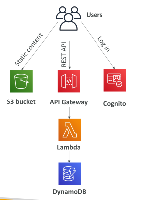

## Why AWS Lambda

• Virtual Servers in the Cloud

• Limited by RAM and CPU

• Continuously running

• Scaling means intervention to add / remove servers

• Virtual functions – no servers to manage!

• Limited by time - short executions

• Run on-demand

• Scaling is automated!

## Benefits of AWS Lambda

Easy Pricing:
 - Pay per request and compute time
 - Free tier of 1,000,000 AWS Lambda requests and 400,000 GBs of compute time

Integrated with the whole AWS suite of services

Integrated with many programming languages

Easy monitoring through AWS CloudWatch

Easy to get more resources per functions (up to 10GB of RAM!)

Increasing RAM will also improve CPU and network!

## AWS Lambda language support

Node.js (JavaScript)

Python

Java

C# (.NET Core) / Powershell

Ruby

Custom Runtime API (community supported, example Rust or Golang)

Lambda Container Image
 - The container image must implement the Lambda Runtime API
 - ECS / Fargate is preferred for running arbitrary Docker images

## AWS Lambda Integrations Main ones

- API Gateway
- Kinesis
- DynamoDB
- S3
- CloudFront
- Cloudwatch events eventbridge
- Cloudwatch logs
- SNS
- SQS
- Cognito

## Example: Serverless Thumbnail creation

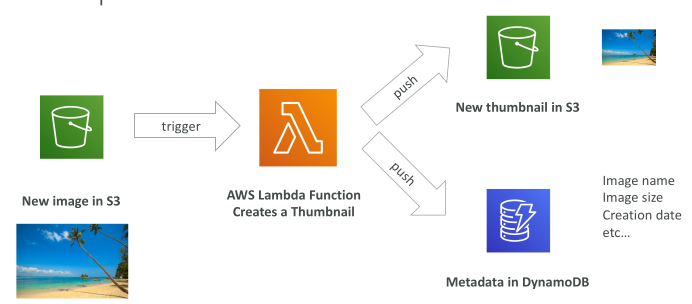

## Example: Serverless CRON Job

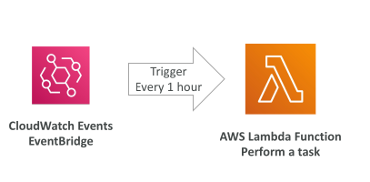

## AWS Lambda Pricing: example

You can find overall pricing information here: https://aws.amazon.com/lambda/pricing/

Pay per calls:
 - First 1,000,000 requests are free
 - $0.20 per 1 million requests thereafter ($0.0000002 per request)

Pay per duration: (in increment of 1 ms)
 - 400,000 GB-seconds of compute time per month for FREE
 - == 400,000 seconds if function is 1GB RAM
 - == 3,200,000 seconds if function is 128 MB RAM
 - After that $1.00 for 600,000 GB-seconds

It is usually very cheap to run AWS Lambda so it’s very popular

## AWS Lambda Limits to Know - per region - EXAM IMPORTANT

Execution:
 - Memory allocation: 128 MB – 10GB (1 MB increments)
 - Maximum execution time: 900 seconds (15 minutes)
 - Environment variables (4 KB)
 - Disk capacity in the “function container” (in /tmp): 512 MB to 10GB
 - Concurrency executions: 1000 (can be increased)

Deployment:
 - Lambda function deployment size (compressed .zip): 50 MB
 - Size of uncompressed deployment (code + dependencies): 250 MB
 - Can use the /tmp directory to load other files at startup
 - Size of environment variables: 4 KB

## Lambda Concurrency and Throttling

Concurrency limit: up to 1000 concurrent executions

Can set a “reserved concurrency” at the function level (=limit)

Each invocation over the concurrency limit will trigger a “Throttle”

Throttle behavior:
 - If synchronous invocation => return ThrottleError - 429
 - If asynchronous invocation => retry automatically and then go to DLQ

If you need a higher limit, open a support ticket

## Lambda Concurrency Issue

• If you don’t reserve (=limit) concurrency, the following can happen:

Terms: Concurrency is the number of function executions running at the same moment. A reserved concurrency is a cap you set on one function that also guarantees it that many slots. A throttle happens when an invocation arrives but the limit is already reached, so Lambda refuses to run it right away. A DLQ (dead-letter queue) is a holding place where events go after all retries have failed, so you can inspect or reprocess them later.

Example: Imagine your account has the default limit of 1000 concurrent executions, and you set reserved concurrency to 100 on a function called processOrders. If 150 requests arrive at the same time, 100 of them run and the other 50 are throttled. How those 50 are handled depends on how the function was invoked. If the calls were synchronous, such as through API Gateway, each throttled caller immediately receives a 429 ThrottleError and must decide whether to retry. If the calls were asynchronous, such as events from S3 or SNS, Lambda automatically retries the throttled events for you, and any that still cannot run end up in the DLQ. Because of the reservation, processOrders always has its 100 slots available, but it can never spike beyond them. And if your overall workload needs more than the 1000 account-wide limit, you would open a support ticket to ask for it to be raised.

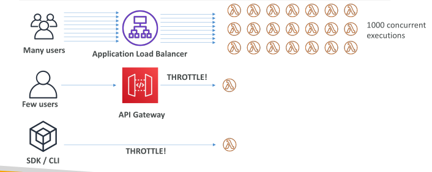

## Concurrency and Asynchronous Invocations

• If the function doesn't have enough concurrency available to process all events,additional requests are throttled.

• For throttling errors (429) and system errors (500-series), Lambda returns the event to the queue and attempts to run the function again for up to 6 hours.

• The retry interval increases exponentially from 1 second after the first attempt to a maximum of 5 minutes.

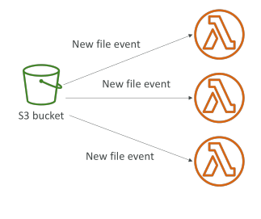

## Cold Starts & Provisioned Concurrency

Cold Start:
 - New instance => code is loaded and code outside the handler run (init)
 - If the init is large (code, dependencies, SDK…) this process can take some time.
 - First request served by new instances has higher latency than the rest

Provisioned Concurrency:
 - Concurrency is allocated before the function is invoked (in advance)
 - So the cold start never happens and all invocations have low latency
 - Application Auto Scaling can manage concurrency (schedule or target utilization)

Note:
 - Note: cold starts in VPC have been dramatically reduced in Oct & Nov 2019
 - https://aws.amazon.com/blogs/compute announcing-improved-vpc-networking-for-aws-lambda-functions/

Terms: A cold start is the delay that happens when Lambda has to create a brand-new execution environment for your function, loading your code and running any initialization code that sits outside the handler (such as importing libraries or creating SDK clients) before it can handle the request. Provisioned concurrency means you pay to have a set number of execution environments prepared in advance, so they are already initialized and waiting. Application Auto Scaling is the AWS service that can raise or lower that provisioned amount automatically, either on a schedule or based on how heavily the environments are being used (target utilization).

Example: A function called generateReport loads a heavy PDF library outside its handler, which takes about 3 seconds. Without provisioned concurrency, the first request after a quiet period triggers a cold start and takes around 3 seconds, while later requests on the warm instance finish in about 200 ms. If you set provisioned concurrency to 20, 20 instances are initialized in advance, so requests are fast every time, and you can use Application Auto Scaling to raise that number before a known peak, like 9 AM. The tradeoff is that you pay for those instances even when idle.

## Reserved and Provisioned Concurrency

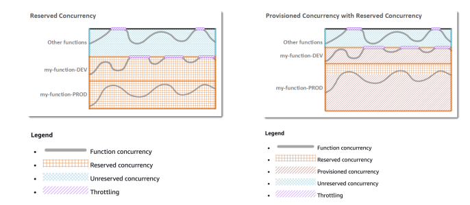

## Lambda SnapStart

• Improves your Lambda functions performance up to 10x at no extra cost for Java, Python & .NET

• When enabled, function is invoked from a pre- initialized state (no function initialization from scratch)

• When you publish a new version:

• Lambda initializes your function

• Takes a snapshot of memory and disk state of the initialized function

• Snapshot is cached for low-latency access

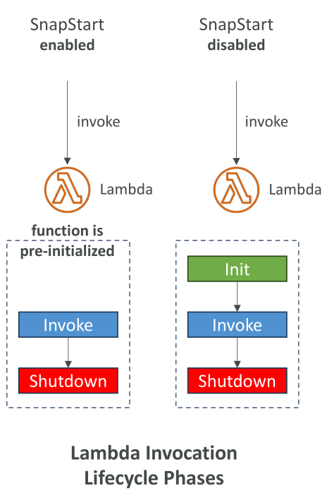

## Customization At The Edge

Many modern applications execute some form of the logic at the edge

Edge Function:
 - A code that you write and attach to CloudFront distributions
 - Runs close to your users to minimize latency

CloudFront provides two types: CloudFront Functions & Lambda@Edge

You don’t have to manage any servers, deployed globally

Use case: customize the CDN content

Pay only for what you use

Fully serverless

## CloudFront Functions & Lambda@Edge Use Cases

Website Security and Privacy

Dynamic Web Application at the Edge

Search Engine Optimization (SEO)

Intelligently Route Across Origins and Data Centers

Bot Mitigation at the Edge

Real-time Image Transformation

A/B Testing

User Authentication and Authorization

User Prioritization

User Tracking and Analytics

## CloudFront Functions

Lightweight functions written in JavaScript

For high-scale, latency-sensitive CDN customizations

Sub-ms startup times, millions of requests/second

Used to change Viewer requests and responses:
 - Viewer Request: after CloudFront receives a request from a viewer
 - Viewer Response: before CloudFront forwards the response to the viewer

Native feature of CloudFront (manage code entirely within CloudFront)

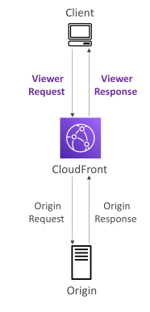

## Lambda@Edge

Lambda functions written in NodeJS or Python

Scales to 1000s of requests/second

Used to change CloudFront requests and responses:
 - Viewer Request – after CloudFront receives a request from a viewer
 - Origin Request – before CloudFront forwards the request to the origin
 - Origin Response – after CloudFront receives the response from the origin
 - Viewer Response – before CloudFront forwards the response to the viewer

Author your functions in one AWS Region (us-east-1), then CloudFront replicates to its locations

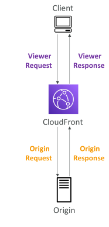

## CloudFront Functions vs. Lambda@Edge

| Feature                                 | CloudFront Functions                               | Lambda@Edge                                                         |
| --------------------------------------- | -------------------------------------------------- | ------------------------------------------------------------------- |
| **Runtime Support**                     | JavaScript                                         | Node.js, Python                                                     |
| **# of Requests**                       | Millions of requests/second                        | Thousands of requests/second                                        |
| **CloudFront Triggers**                 | Viewer Request / Viewer Response                   | Viewer Request / Viewer Response / Origin Request / Origin Response |
| **Max. Execution Time**                 | < 1 ms                                             | 5–10 seconds                                                        |
| **Max. Memory**                         | 2 MB                                               | 128 MB up to 10 GB                                                  |
| **Total Package Size**                  | 10 KB                                              | 1 MB – 50 MB                                                        |
| **Network Access / File System Access** | No                                                 | Yes                                                                 |
| **Access to Request Body**              | No                                                 | Yes                                                                 |
| **Pricing**                             | Free tier available; ~1/6 the price of Lambda@Edge | No free tier; charged per request & duration                        |

## CloudFront Functions vs. Lambda@Edge - Use Cases

| CloudFront Functions                                                                              | Lambda@Edge                                                                                |
| ------------------------------------------------------------------------------------------------- | ------------------------------------------------------------------------------------------ |
| **Cache key normalization** — Optimize cache keys using headers, cookies, query strings, and URLs | **Longer execution time** — Several milliseconds                                           |
| **Header manipulation** — Insert, modify, or delete HTTP headers                                  | **Adjustable CPU / memory**                                                                |
| **URL rewrites / redirects**                                                                      | **Third-party libraries** — Use libraries such as the AWS SDK to access other AWS services |
| **Request authentication & authorization** — Create/validate tokens such as JWTs                  | **Network access** — Connect to external services                                          |
| **Lightweight request/response processing**                                                       | **File system access**                                                                     |
| **Cannot access HTTP request body**                                                               | **Can access the HTTP request body**                                                       |

## Lambda by default

• By default, your Lambda function is launched outside your own VPC (in an AWS-owned VPC)

• Therefore, it cannot access resources in your VPC (RDS, ElastiCache, internal ELB…)

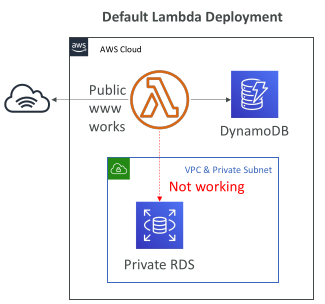

## Lambda in VPC

• You must define the VPC ID, the Subnets and the Security Groups

• Lambda will create an ENI (Elastic Network Interface) in your subnets

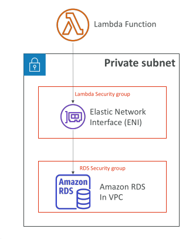

## Lambda with RDS Proxy - Exam important

If Lambda functions directly access your database, they may open too many connections under high load

RDS Proxy
 - Improve scalability by pooling and sharing DB connections
 - Improve availability by reducing by 66% the failover time and preserving connections
 - Improve security by enforcing IAM authentication and storing credentials in Secrets Manager

The Lambda function must be deployed in your VPC, because RDS Proxy is never publicly accessible

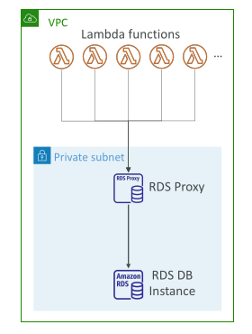

## Invoking Lambda from RDS & Aurora

Invoke Lambda functions from within your DB instance

Allows you to process data events from within a database

Supported for RDS for PostgreSQL and Aurora MySQL

Must allow outbound traffic to your Lambda function from within your DB instance (Public, NAT GW, VPC Endpoints)

DB instance must have the required permissions to invoke the Lambda function (Lambda Resource-based Policy & IAM Policy)

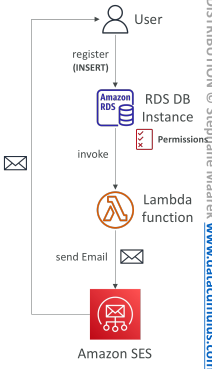

## RDS Event Notifications

Notifications that tells information about the DB instance itself (created, stopped, start, …)

You don’t have any information about the data itself

Subscribe to the following event categories: DB instance, DB snapshot, DB Parameter 

Group, DB Security Group, RDS Proxy, Custom Engine Version

Near real-time events (up to 5 minutes)

Send notifications to SNS or subscribe to events using EventBridge

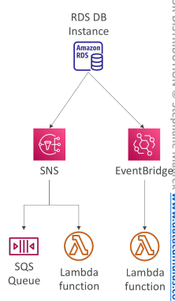
