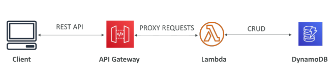
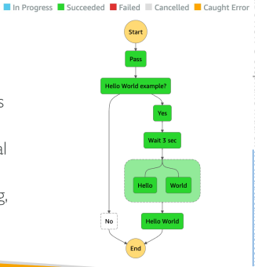

## Example: Building a Serverless API

## API Gateway - Endpoint Types

Edge-Optimized (default): For global clients
 - Requests are routed through the CloudFront Edge locations (improves latency)
 - The API Gateway still lives in only one region

Regional:
 - For clients within the same region
 - Could manually combine with CloudFront (more control over the caching strategies and the distribution)

Private:
 - Can only be accessed from your VPC using an interface VPC endpoint (ENI)
 - Use a resource policy to define access

## API Gateway – Security

User Authentication through
 - IAM Roles (useful for internal applications)
 - Cognito (identity for external users – example mobile users)
 - Custom Authorizer (your own logic)

Custom Domain Name HTTPS security through integration with AWS Certificate Manager (ACM)
 - If using Edge-Optimized endpoint, then the certificate must be in us-east-1
 - If using Regional endpoint, the certificate must be in the API Gateway region
 - Must setup CNAME or A-alias record in Route 53

## Step functions

## AWS Step Functions

Build serverless visual workflow to orchestrate your Lambda functions

Features: sequence, parallel, conditions, timeouts, error handling, …

Can integrate with EC2, ECS, On-premises servers, API Gateway, SQS queues, etc…

Possibility of implementing human approval feature

Use cases: order fulfillment, data processing, web applications, any workflow

