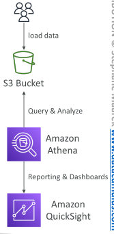
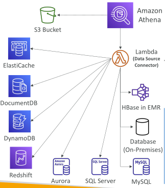
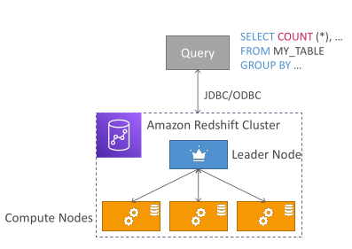
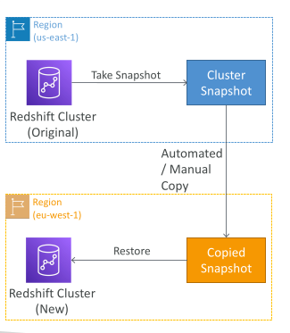
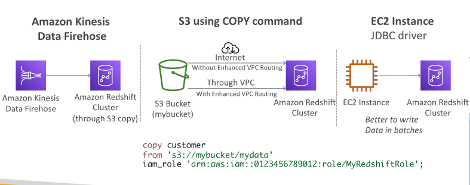
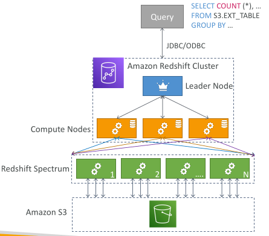
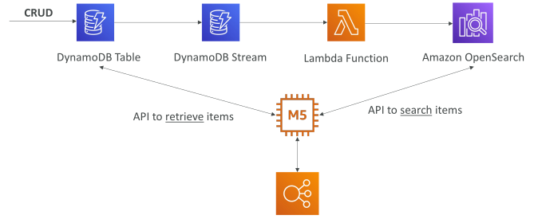
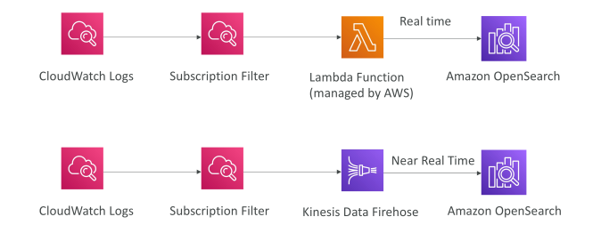
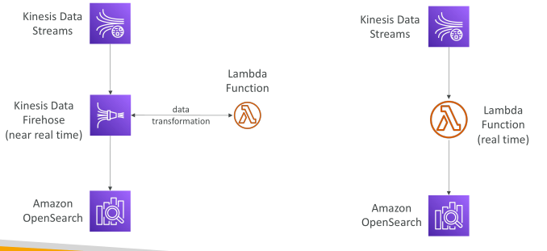

## Amazone athena

Serverless query service to analyze data stored in Amazon S3

Uses standard SQL language to query the files (built on Presto)

Supports CSV, JSON, ORC, Avro, and Parquet

Pricing: $5.00 per TB of data scanned

Commonly used with Amazon Quicksight for reporting/dashboards

Use cases: Business intelligence / analytics / reporting, analyze & query VPC Flow Logs, ELB Logs, CloudTrail trails, etc...

Exam Tip: analyze data in S3 using serverless SQL, use Athena

## Amazon Athena – Performance Improvement

Use columnar data for cost-savings (less scan)
 - Apache Parquet or ORC is recommended
 - Huge performance improvement
 - Use Glue to convert your data to Parquet or ORC

Compress data for smaller retrievals (bzip2, gzip, lz4, snappy, zlip, zstd…)

Partition datasets in S3 for easy querying on virtual columns
    s3://yourBucket/pathToTable
    /<PARTITION_COLUMN_NAME>=<VALUE>
    /<PARTITION_COLUMN_NAME>=<VALUE>
    /<PARTITION_COLUMN_NAME>=<VALUE>
    /etc…
Example: s3://athena-examples/flight/parquet/year=1991/month=1/day=1/

Use larger files (> 128 MB) to minimize overhead

## Amazon Athena – Federated Query

• Allows you to run SQL queries across data stored in relational, non-relational, object, and custom data sources (AWS or on-premises)

• Uses Data Source Connectors that run on AWS Lambda to run Federated Queries (e.g., CloudWatch Logs, DynamoDB, RDS, …)

• Store the results back in Amazon S3

## Redshift Overview

• Redshift is based on PostgreSQL, but it’s not used for OLTP

• It’s OLAP – online analytical processing (analytics and data warehousing)

• 10x better performance than other data warehouses, scale to PBs of data

• Columnar storage of data (instead of row based) & parallel query engine

• Two modes: Provisioned cluster or Serverless cluster

• Has a SQL interface for performing the queries

• BI tools such as Amazon Quicksight or Tableau integrate with it

• vs Athena: faster queries / joins / aggregations thanks to indexes

## Redshift Cluster

Leader node: for query planning, results aggregation

Compute node: for performing the queries, send results to leader

Provisioned mode:
 - Choose instance types in advance
 - Can reserve instances for cost savings

## Redshift – Snapshots & DR

• Redshift has “Multi-AZ” mode for some clusters

• Snapshots are point-in-time backups of a cluster, stored internally in S3

• Snapshots are incremental (only what has changed is saved)

• You can restore a snapshot into a new cluster

• Automated: every 8 hours, every 5 GB, or on a schedule. Set retention between 1 to 35 days

• Manual: snapshot is retained until you delete it

• You can configure Amazon Redshift to automatically copy snapshots (automated or manual) of a cluster to another AWS Region

## Loading data into Redshift: Large inserts are MUCH better

## Redshift Spectrum

• Query data that is already in S3 without loading it

• Must have a Redshift cluster available to start the query

• The query is then submitted to thousands of Redshift Spectrum nodes

## Amazon OpenSearch Service

• Amazon OpenSearch is successor to Amazon ElasticSearch

• In DynamoDB, queries only exist by primary key or indexes…

• With OpenSearch, you can search any field, even partially matches

• It’s common to use OpenSearch as a complement to another database

• Two modes: managed cluster or serverless cluster

• Does not natively support SQL (can be enabled via a plugin)

• Ingestion from Kinesis Data Firehose, AWS IoT, and CloudWatch Logs

• Security through Cognito & IAM, KMS encryption, TLS

• Comes with OpenSearch Dashboards (visualization)

## OpenSearch patterns DynamoDB

## OpenSearch patterns CloudWatch Logs

## OpenSearch patterns Kinesis Data Streams & Kinesis Data Firehose

