## Amazone athena

Serverless query service to analyze data stored in Amazon S3

Uses standard SQL language to query the files (built on Presto)

Supports CSV, JSON, ORC, Avro, and Parquet

Pricing: $5.00 per TB of data scanned

Commonly used with Amazon Quicksight for reporting/dashboards

Use cases: Business intelligence / analytics / reporting, analyze & query VPC Flow Logs, ELB Logs, CloudTrail trails, etc...

Exam Tip: analyze data in S3 using serverless SQL, use Athena

## Amazon Athena – Performance Improvement - Exam important

Use columnar data for cost-savings (less scan)
 - Apache Parquet or ORC is recommended
 - Huge performance improvement
 - Use Glue to convert your data to Parquet or ORC

Compress data for smaller retrievals (bzip2, gzip, lz4, snappy, zlip, zstd…)

Partition datasets in S3 for easy querying on virtual columns
    s3://yourBucket/pathToTable
    /<PARTITION_COLUMN_NAME>=<VALUE>
    /<PARTITION_COLUMN_NAME>=<VALUE>
    /<PARTITION_COLUMN_NAME>=<VALUE>
    /etc…
Example: s3://athena-examples/flight/parquet/year=1991/month=1/day=1/

Use larger files (> 128 MB) to minimize overhead

## Amazon Athena – Federated Query

• Allows you to run SQL queries across data stored in relational, non-relational, object, and custom data sources (AWS or on-premises)

• Uses Data Source Connectors that run on AWS Lambda to run Federated Queries (e.g., CloudWatch Logs, DynamoDB, RDS, …)

• Store the results back in Amazon S3

## Redshift Overview

• Redshift is based on PostgreSQL, but it’s not used for OLTP

• It’s OLAP – online analytical processing (analytics and data warehousing)

• 10x better performance than other data warehouses, scale to PBs of data

• Columnar storage of data (instead of row based) & parallel query engine

• Two modes: Provisioned cluster or Serverless cluster

• Has a SQL interface for performing the queries

• BI tools such as Amazon Quicksight or Tableau integrate with it

• vs Athena: faster queries / joins / aggregations thanks to indexes

## Redshift Cluster

Leader node: for query planning, results aggregation

Compute node: for performing the queries, send results to leader

Provisioned mode:
 - Choose instance types in advance
 - Can reserve instances for cost savings

## Redshift – Snapshots & DR

• Redshift has “Multi-AZ” mode for some clusters

• Snapshots are point-in-time backups of a cluster, stored internally in S3

• Snapshots are incremental (only what has changed is saved)

• You can restore a snapshot into a new cluster

• Automated: every 8 hours, every 5 GB, or on a schedule. Set retention between 1 to 35 days

• Manual: snapshot is retained until you delete it

• You can configure Amazon Redshift to automatically copy snapshots (automated or manual) of a cluster to another AWS Region

## Loading data into Redshift: Large inserts are MUCH better

## Redshift Spectrum

• Query data that is already in S3 without loading it

• Must have a Redshift cluster available to start the query

• The query is then submitted to thousands of Redshift Spectrum nodes

## Amazon OpenSearch Service

• Amazon OpenSearch is successor to Amazon ElasticSearch

• In DynamoDB, queries only exist by primary key or indexes…

• With OpenSearch, you can search any field, even partially matches

• It’s common to use OpenSearch as a complement to another database

• Two modes: managed cluster or serverless cluster

• Does not natively support SQL (can be enabled via a plugin)

• Ingestion from Kinesis Data Firehose, AWS IoT, and CloudWatch Logs

• Security through Cognito & IAM, KMS encryption, TLS

• Comes with OpenSearch Dashboards (visualization)

## OpenSearch patterns DynamoDB

## OpenSearch patterns CloudWatch Logs

## OpenSearch patterns Kinesis Data Streams & Kinesis Data Firehose

## Amazon EMR

• EMR stands for “Elastic MapReduce”

• EMR helps creating Hadoop clusters (Big Data) to analyze and process vast amount of data

• The clusters can be made of hundreds of EC2 instances

• EMR comes bundled with Apache Spark, HBase, Presto, Flink…

• EMR takes care of all the provisioning and configuration

• Auto-scaling and integrated with Spot instances

• Use cases: data processing, machine learning, web indexing, big data…

## Amazon EMR – Node types & purchasing

Master Node: Manage the cluster, coordinate, manage health – long running

Core Node: Run tasks and store data – long running

Task Node (optional): Just to run tasks – usually Spot

Purchasing options:
 - On-demand: reliable, predictable, won’t be terminated
 - Reserved (min 1 year): cost savings (EMR will automatically use if available)
 - Spot Instances: cheaper, can be terminated, less reliable

Can have long-running cluster, or transient (temporary) cluster

## Amazon QuickSight

Serverless machine learning-powered business intelligence service to create interactive dashboards

Fast, automatically scalable, embeddable, with per-session pricing

Use cases:
 - Business analytics
 - Building visualizations
 - Perform ad-hoc analysis
 - Get business insights using data

Integrated with RDS, Aurora, Athena, Redshift, S3…

In-memory computation using SPICE engine if data is imported into QuickSight

Enterprise edition: Possibility to setup Column-Level security (CLS)

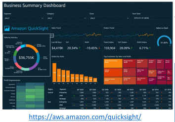

## QuickSight Integrations

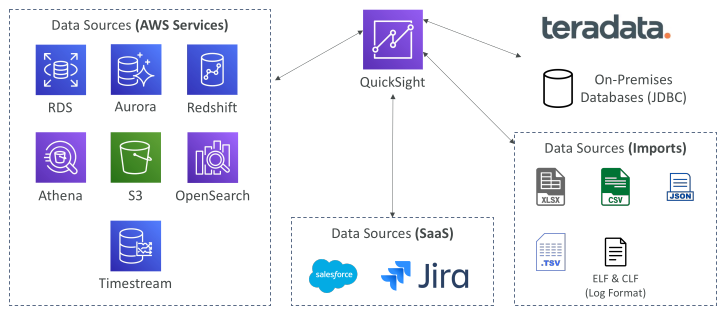

## QuickSight – Dashboard & Analysis

Define Users (standard versions) and Groups (enterprise version)
 - These users & groups only exist within QuickSight, not IAM !!

A dashboard…
 - is a read-only snapshot of an analysis that you can share
 - preserves the configuration of the analysis (filtering, parameters, controls, sort)

You can share the analysis or the dashboard with Users or Groups

To share a dashboard, you must first publish it

Users who see the dashboard can also see the underlying data

## AWS Glue

• Managed extract, transform, and load (ETL) service

• Useful to prepare and transform data for analytics

• Fully serverless service

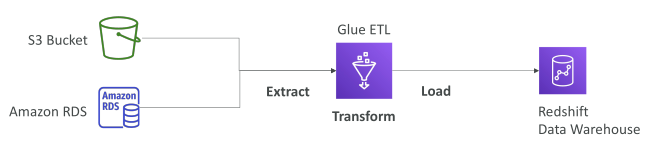

## AWS Glue – Convert data into Parquet format - Exam important

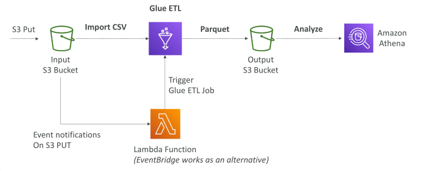

## Glue Data Catalog: catalog of datasets

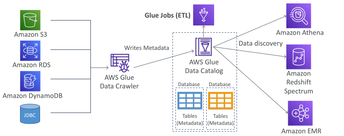

## Glue – things to know at a high-level - Exam important

• Glue Job Bookmarks: prevent re-processing old data

• Glue DataBrew: clean and normalize data using pre-built transformation

• Glue Studio: new GUI to create, run and monitor ETL jobs in Glue

• Glue Streaming ETL (built on Apache Spark Structured Streaming): compatible with Kinesis Data Streaming, Kafka, MSK (managed Kafka)

## AWS Lake Formation - Exam important

• Data lake = central place to have all your data for analytics purposes

• Fully managed service that makes it easy to setup a data lake in days

• Discover, cleanse, transform, and ingest data into your Data Lake

• It automates many complex manual steps (collecting, cleansing, moving, cataloging data, …) and de-duplicate (using ML Transforms)

• Combine structured and unstructured data in the data lake

• Out-of-the-box source blueprints: S3, RDS, Relational & NoSQL DB…

• Fine-grained Access Control for your applications (row and column-level)

• Built on top of AWS Glue

## AWS Lake Formation - Exam important

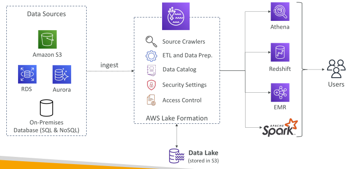

## AWS Lake Formation Centralized Permissions Example

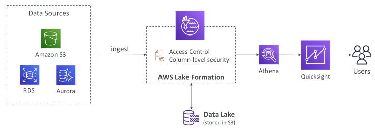

## Amazon Managed Service for Apache Flink

Previously named: Kinesis Data Analytics for Apache Flink
Flink (Java, Scala or SQL) is a framework for processing data streams

Run any Apache Flink application on a managed cluster on AWS
 - Provisioned compute resources, parallel computation, automatic scaling
 - Application backups (implemented as checkpoints and snapshots)
 - Use any Apache Flink programming features to transform data
 - Important: Flink does not read from Amazon Data Firehose

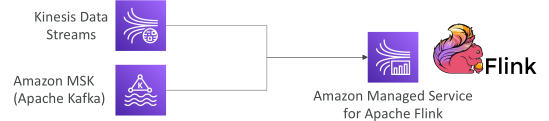

## Amazon Managed Streaming for Apache Kafka (Amazon MSK)

Alternative to Amazon Kinesis

Fully managed Apache Kafka on AWS
 - Allow you to create, update, delete clusters
 - MSK creates & manages Kafka brokers nodes & Zookeeper nodes for you
 - Deploy the MSK cluster in your VPC, multi-AZ (up to 3 for HA)
 - Automatic recovery from common Apache Kafka failures
 - Data is stored on EBS volumes for as long as you want

MSK Serverless
 - Run Apache Kafka on MSK without managing the capacity
 - MSK automatically provisions resources and scales compute & storage

## Apache Kafka at a high level

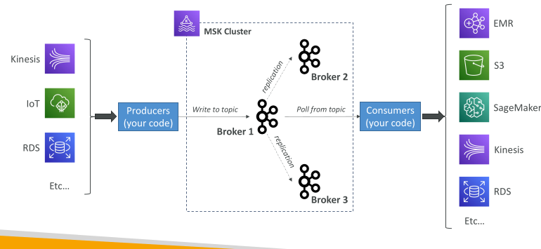

## Kinesis Data Streams vs. Amazon MSK

| Feature              | Kinesis Data Streams          | Amazon MSK                                      |
| -------------------- | ----------------------------- | ----------------------------------------------- |
| Message size         | 1 MB limit                    | 1 MB default, configurable higher (e.g., 10 MB) |
| Data organization    | Data Streams with **Shards**  | Kafka Topics with **Partitions**                |
| Scaling              | **Shard splitting & merging** | Can **only add partitions** to a topic          |
| In-flight encryption | TLS                           | PLAINTEXT or TLS                                |
| At-rest encryption   | KMS                           | KMS                                             |

## Amazon MSK Consumers

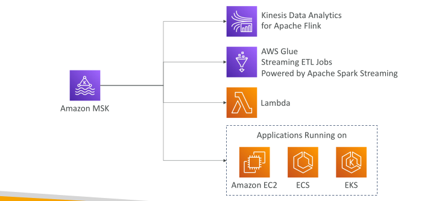

## Big Data Ingestion Pipeline

• We want the ingestion pipeline to be fully serverless

• We want to collect data in real time

• We want to transform the data

• We want to query the transformed data using SQL

• The reports created using the queries should be in S3

• We want to load that data into a warehouse and create dashboards

## Big Data Ingestion Pipeline

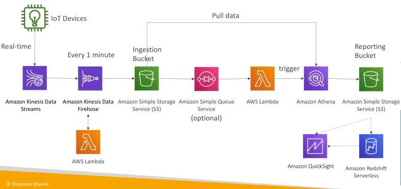

## Big Data Ingestion Pipeline discussion

• IoT Core allows you to harvest data from IoT devices

• Kinesis is great for real-time data collection

• Firehose helps with data delivery to S3 in near real-time (1 minute)

• Lambda can help Firehose with data transformations

• Amazon S3 can trigger notifications to SQS

• Lambda can subscribe to SQS (we could have connecter S3 to Lambda)

• Athena is a serverless SQL service and results are stored in S3

• The reporting bucket contains analyzed data and can be used by reporting tool such as AWS QuickSight, Redshift, etc…

