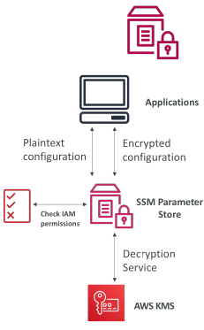
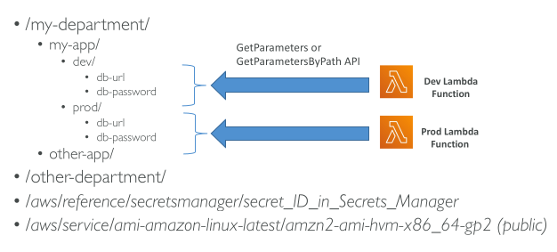
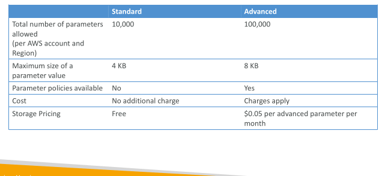
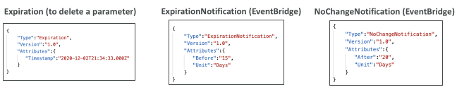

## SSM Parameter Store

• Secure storage for configuration and secrets

• Optional Seamless Encryption using KMS

• Serverless, scalable, durable, easy SDK

• Version tracking of configurations / secrets

• Security through IAM

• Notifications with Amazon EventBridge

• Integration with CloudFormation

## SSM Parameter Store Hierarchy

## Standard and advanced parameter tiers

## Parameters Policies (for advanced parameters)

• Allow to assign a TTL to a parameter (expiration date) to force updating or deleting sensitive data such as passwords

• Can assign multiple policies at a time

