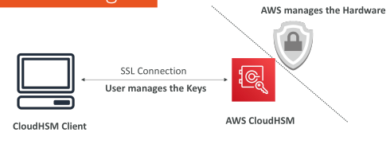
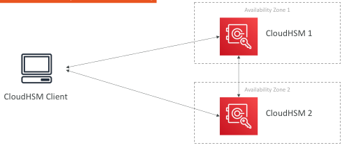
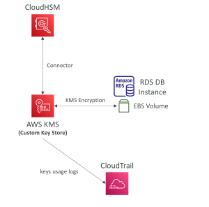
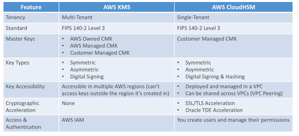
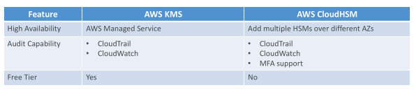

## CloudHSM

• KMS => AWS manages the software for encryption

• CloudHSM => AWS provisions encryption hardware

• Dedicated Hardware (HSM = Hardware Security Module)

• You manage your own encryption keys entirely (not AWS)

• HSM device is tamper resistant, FIPS 140-2 Level 3 compliance

• Supports both symmetric and asymmetric encryption (SSL/TLS keys)

• No free tier available

• Must use the CloudHSM Client Software

• Redshift supports CloudHSM for database encryption and key management

• Good option to use with SSE-C encryption

## CloudHSM Diagram

IAM permissions:
 - CRUD an HSM Cluster

CloudHSM Software:
 - Manage the Keys
 - Manage the Users

## CloudHSM – High Availability

• CloudHSM clusters are spread across Multi AZ (HA)

• Great for availability and durability

## CloudHSM – Integration with AWS Services

• Through integration with AWS KMS

• Configure KMS Custom Key Store with CloudHSM
• Example: EBS, S3, RDS …

## CloudHSM vs. KMS

## CloudHSM vs. KMS

