## Amazon VPC

## VPC Components Diagram

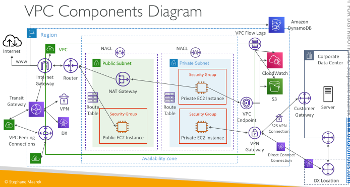

## Understanding CIDR – IPv4

• Classless Inter-Domain Routing – a method for allocating IP addresses

• Used in Security Groups rules and AWS networking in general

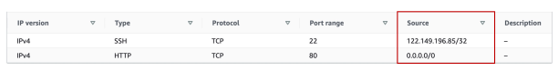

They help to define an IP address range:
 - We’ve seen WW.XX.YY.ZZ/32 => one IP
 - We’ve seen 0.0.0.0/0 => all IPs
 - But we can define:192.168.0.0/26 =>192.168.0.0 – 192.168.0.63 (64 IP addresses)

## Understanding CIDR – IPv4

A CIDR consists of two components

Base IP
 - Represents an IP contained in the range (XX.XX.XX.XX)
 - Example: 10.0.0.0, 192.168.0.0, …

Subnet Mask
 - Defines how many bits can change in the IP
 - Example: /0, /24, /32
 - Can take two forms:
   - /8 ó 255.0.0.0
   - /16 ó 255.255.0.0
   - /24 ó 255.255.255.0
   - /32 ó 255.255.255.255

## Understanding CIDR – Subnet Mask

• The Subnet Mask basically allows part of the underlying IP to get additional next values from the base IP

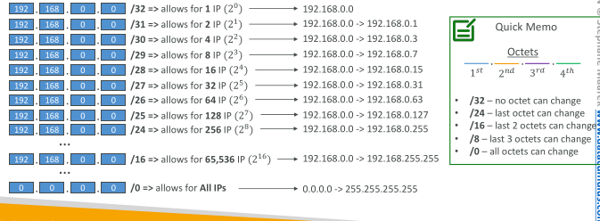

## Understanding CIDR – Little Exercise

192.168.0.0/24 = … ?
 - 192.168.0.0 – 192.168.0.255 (256 IPs)

192.168.0.0/16 = … ?
 - 192.168.0.0 – 192.168.255.255 (65,536 IPs)

134.56.78.123/32 = … ?
 - Just 134.56.78.123

0.0.0.0/0
 - All IPs!

When in doubt, use this website https://www.ipaddressguide.com/cidr

## Public vs. Private IP (IPv4)

• The Internet Assigned Numbers Authority (IANA) established certain blocks of IPv4 addresses for the use of private (LAN) and public (Internet) addresses

Private IP can only allow certain values:
 - 10.0.0.0 – 10.255.255.255 (10.0.0.0/8) ç in big networks
 - 172.16.0.0 – 172.31.255.255 (172.16.0.0/12) ç AWS default VPC in that range
 - 192.168.0.0 – 192.168.255.255 (192.168.0.0/16) ç e.g., home networks

All the rest of the IP addresses on the Internet are Public

## Default VPC Walkthrough

All new AWS accounts have a default VPC

New EC2 instances are launched into the default VPC if no subnet is specified

Default VPC has Internet connectivity and all EC2 instances inside it have public IPv4 addresses

We also get a public and a private IPv4 DNS names

## VPC in AWS – IPv4

VPC = Virtual Private Cloud

You can have multiple VPCs in an AWS region (max. 5 per region – soft limit)

Max. CIDR per VPC is 5, for each CIDR:
 - Min. size is /28 (16 IP addresses)
 - Max. size is /16 (65536 IP addresses)

Because VPC is private, only the Private IPv4 ranges are allowed:
 - 10.0.0.0 – 10.255.255.255 (10.0.0.0/8)
 - 172.16.0.0 – 172.31.255.255 (172.16.0.0/12)
 - 192.168.0.0 – 192.168.255.255 (192.168.0.0/16)

Your VPC CIDR should NOT overlap with your other networks (e.g., corporate)

## State of Hands-on

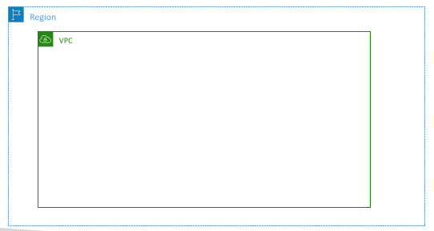

## Adding Subnets

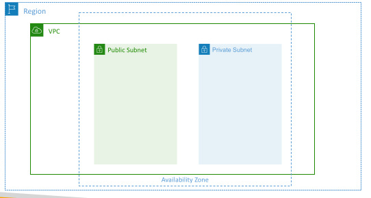

## VPC – Subnet (IPv4) - EXAM IMPORTANT

AWS reserves 5 IP addresses (first 4 & last 1) in each subnet

These 5 IP addresses are not available for use and can’t be assigned to an EC2 instance

Example: if CIDR block 10.0.0.0/24, then reserved IP addresses are:
 - 10.0.0.0 – Network Address
 - 10.0.0.1 – reserved by AWS for the VPC router
 - 10.0.0.2 – reserved by AWS for mapping to Amazon-provided DNS
 - 10.0.0.3 – reserved by AWS for future use
 - 10.0.0.255 – Network Broadcast Address. AWS does not support broadcast in a VPC, therefore the address is reserved

Exam Tip, if you need 29 IP addresses for EC2 instances:
 - You can’t choose a subnet of size /27 (32 IP addresses, 32 – 5 = 27 < 29)
 - You need to choose a subnet of size /26 (64 IP addresses, 64 – 5 = 59 > 29)

## Internet Gateway (IGW)

Allows resources (e.g., EC2 instances) in a VPC connect to the Internet

It scales horizontally and is highly available and redundant

Must be created separately from a VPC

One VPC can only be attached to one IGW and vice versa

Internet Gateways on their own do not allow Internet access…

Route tables must also be edited!

## Adding Internet Gateway

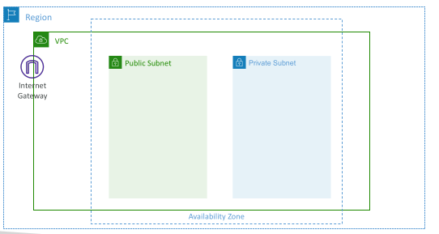

## Editing Route Tables

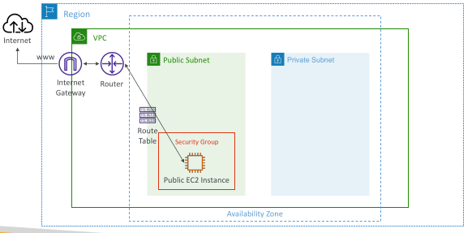

## Bastion Hosts

• We can use a Bastion Host to SSH into our private EC2 instances

• The bastion is in the public subnet which is then connected to all other private subnets

• Bastion Host security group must allow inbound from the internet on port 22 from restricted CIDR, for example the public CIDR of your corporation

• Security Group of the EC2 Instances must allow the Security Group of the Bastion Host, or the private IP of the Bastion host

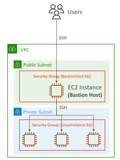

## NAT Instance (outdated, but still at the exam)

• NAT = Network Address Translation

• Allows EC2 instances in private subnets to connect to the Internet

• Must be launched in a public subnet

• Must disable EC2 setting: Source / destination Check

• Must have Elastic IP attached to it

• Route Tables must be configured to route traffic from private subnets to the NAT Instance

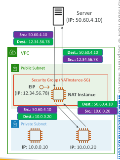

## NAT Instance

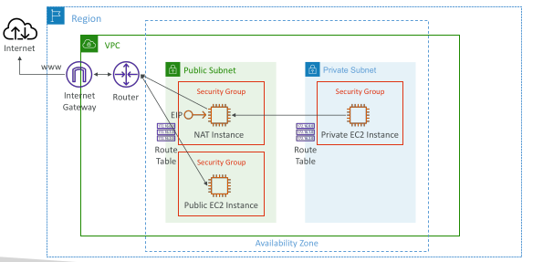

## NAT Instance – Comments

Pre-configured Amazon Linux AMI is available
Reached the end of standard support on December 31, 2020

Not highly available / resilient setup out of the box
You need to create an ASG in multi-AZ + resilient user-data script

Internet traffic bandwidth depends on EC2 instance type

You must manage Security Groups & rules:
 - Inbound:
   - Allow HTTP / HTTPS traffic coming from Private Subnets
   - Allow SSH from your home network (access is provided through Internet Gateway)
 - Outbound:
   - Allow HTTP / HTTPS traffic to the Internet

## NAT Gateway

• AWS-managed NAT, higher bandwidth, high availability, no administration

• Pay per hour for usage and bandwidth

• NATGW is created in a specific Availability Zone, uses an Elastic IP

• Can’t be used by EC2 instance in the same subnet (only from other subnets)

• Requires an IGW (Private Subnet => NATGW => IGW)

• 5 Gbps of bandwidth with automatic scaling up to 100 Gbps

• No Security Groups to manage / required

## NAT Gateway

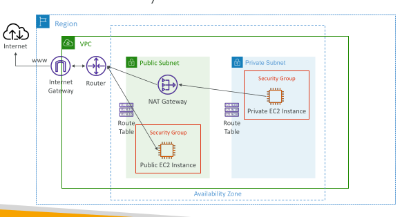

## NAT Gateway with High Availability

• NAT Gateway is resilient within asingle Availability Zone

• Must create multiple NAT Gateways in multiple AZs for fault-tolerance

• There is no cross-AZ failover needed because if an AZ goes down it doesn't need NAT

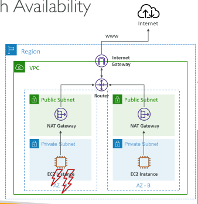

## NAT Gateway vs. NAT Instance - Exam important

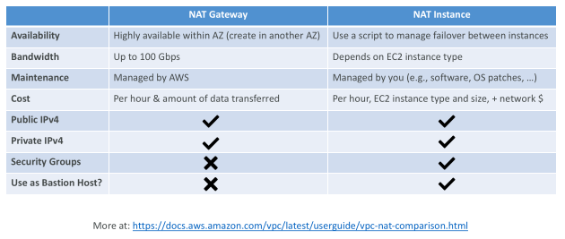

## Regional NAT Gateway (RNAT)

• Highly available NAT Gateway associated with VPC

• RNAT has its own route tables

• Eliminating the need for per-AZ deployments (shared across AZs)

• You don’t need to create Public Subnets in your VPC to host RNAT

• Automatically detects resources in a new AZ and expands to this AZ

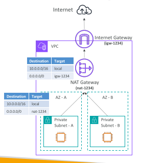

## Security Groups & NACLs

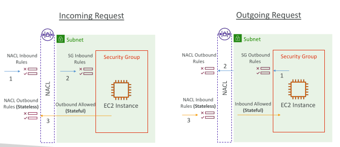

## Network Access Control List (NACL)

NACL are like a firewall which control traffic from and to subnets

One NACL per subnet, new subnets are assigned the Default NACL

You define NACL Rules:
 - Rules have a number (1-32766), higher precedence with a lower number
 - First rule match will drive the decision
 - Example: if you define #100 ALLOW 10.0.0.10/32 and #200 DENY 10.0.0.10/32, the IP address will be allowed because 100 has a higher precedence over 200
 - The last rule is an asterisk (*) and denies a request in case of no rule match
 - AWS recommends adding rules by increment of 100

Newly created NACLs will deny everything

NACL are a great way of blocking a specific IP address at the subnet level

## NACLs

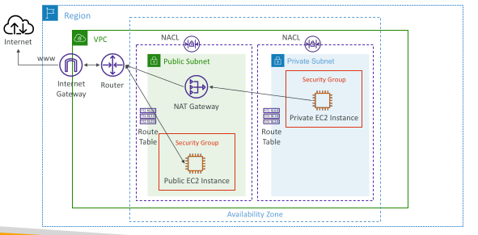

## Default NACL - Exam important

• Accepts everything inbound/outbound with the subnets it’s associated with
• Do NOT modify the Default NACL, instead create custom NACLs

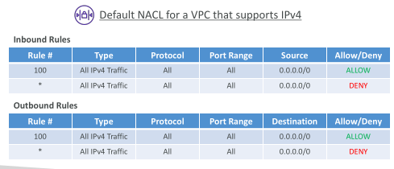

## Ephemeral Ports

For any two endpoints to establish a connection, they must use ports

Clients connect to a defined port, and expect a response on an ephemeral port

Different Operating Systems use different port ranges, examples:
 - IANA & MS Windows 10 è 49152 – 65535
 - Many Linux Kernels è 32768 – 60999

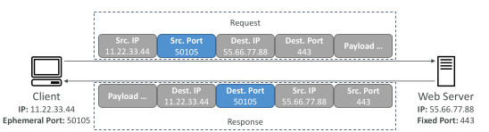

## NACL with Ephemeral Ports

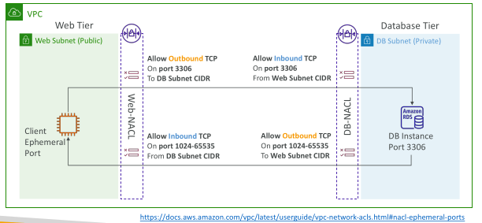

## Create NACL rules for each target subnets CIDR

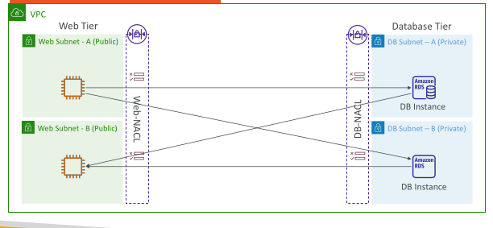

## Security Group vs. NACLs

| **Security Group (SG)**                                                    | **Network ACL (NACL)**                                                                       |
| -------------------------------------------------------------------------- | -------------------------------------------------------------------------------------------- |
| Operates at the **instance level**                                         | Operates at the **subnet level**                                                             |
| Supports **allow rules only**                                              | Supports **allow and deny rules**                                                            |
| **Stateful**: return traffic is automatically allowed, regardless of rules | **Stateless**: return traffic must be explicitly allowed by rules (think of ephemeral ports) |
| **All rules are evaluated** before deciding whether to allow traffic       | Rules are evaluated **in order (lowest to highest)**; first match wins                       |
| Applies to an EC2 instance when **specified/associated**                   | Automatically applies to **all EC2 instances in the associated subnet**                      |
