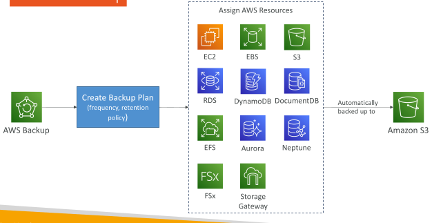
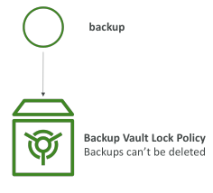
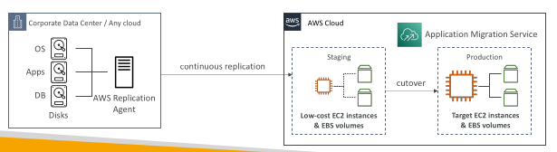
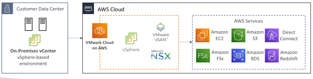

## Disaster Recovery & Migrations

## Disaster Recovery Overview

Any event that has a negative impact on a company’s business continuity or finances is a disaster

Disaster recovery (DR) is about preparing for and recovering from a disaster

What kind of disaster recovery?
 - On-premise => On-premise: traditional DR, and very expensive
 - On-premise => AWS Cloud: hybrid recovery
 - AWS Cloud Region A => AWS Cloud Region B

Need to define two terms:
 - RPO: Recovery Point Objective
 - RTO: Recovery Time Objective

## RPO and RTO

## Disaster Recovery Strategies

• Backup and Restore

• Pilot Light

• Warm Standby

• Hot Site / Multi Site Approach

## Backup and Restore (High RPO)

## Disaster Recovery – Pilot Light

• A small version of the app is always running in the cloud

• Useful for the critical core (pilot light)

• Very similar to Backup and Restore

• Faster than Backup and Restore as critical systems are already up

## Warm Standby

• Full system is up and running, but at minimum size

• Upon disaster, we can scale to production load

## Multi Site / Hot Site Approach

• Very low RTO (minutes or seconds) – very expensive
• Full Production Scale is running AWS and On Premise

## All AWS Multi Region

## Disaster Recovery Tips

Backup
 - EBS Snapshots, RDS automated backups / Snapshots, etc…
 - Regular pushes to S3 / S3 IA / Glacier, Lifecycle Policy, Cross Region Replication
 - From On-Premise: Snowball or Storage Gateway

High Availability
 - Use Route53 to migrate DNS over from Region to Region
 - RDS Multi-AZ, ElastiCache Multi-AZ, EFS, S3
 - Site to Site VPN as a recovery from Direct Connect

Replication
 - RDS Replication (Cross Region), AWS Aurora + Global Databases
 - Database replication from on-premises to RDS
 - Storage Gateway

Automation
 - CloudFormation / Elastic Beanstalk to re-create a whole new environment
 - Recover / Reboot EC2 instances with CloudWatch if alarms fail
 - AWS Lambda functions for customized automations

Chaos
 - Netflix has a “simian-army” randomly terminating EC2

 
## AWS Elastic Disaster Recovery (DRS)

• Used to be named “CloudEndure Disaster Recovery”

• Quickly and easily recover your physical, virtual, and cloud-based servers into AWS

• Example: protect your most critical databases (including Oracle, MySQL, and SQL Server), enterprise apps (SAP), protect your data from ransomware attacks, …

• Continuous block-level replication for your servers

## DMS – Database Migration Service

Quickly and securely migrate databases to AWS, resilient, self healing

The source database remains available during the migration

Supports:
 - Homogeneous migrations: ex Oracle to Oracle
 - Heterogeneous migrations: ex Microsoft SQL Server to Aurora

Continuous Data Replication using CDC

You must create an EC2 instance to perform the replication tasks

## DMS Sources and Targets

| **AWS DMS Sources**                                                                               | **AWS DMS Targets**                                                                 |
| ------------------------------------------------------------------------------------------------- | ----------------------------------------------------------------------------------- |
| On-Premises & EC2 databases: Oracle, MS SQL Server, MySQL, MariaDB, PostgreSQL, MongoDB, SAP, DB2 | On-Premises & EC2 databases: Oracle, MS SQL Server, MySQL, MariaDB, PostgreSQL, SAP |
| Azure SQL Database                                                                                | Amazon RDS                                                                          |
| Amazon RDS (all, including Aurora)                                                                | Redshift                                                                            |
| Amazon S3                                                                                         | DynamoDB                                                                            |
| DocumentDB                                                                                        | S3                                                                                  |
|                                                                                                   | OpenSearch Service                                                                  |
|                                                                                                   | Kinesis Data Streams                                                                |
|                                                                                                   | Apache Kafka                                                                        |
|                                                                                                   | DocumentDB & Amazon Neptune                                                         |
|                                                                                                   | Redis & Babelfish                                                                   |

## AWS Schema Conversion Tool (SCT)

Convert your Database’s Schema from one engine to another

Example OLTP: (SQL Server or Oracle) to MySQL, PostgreSQL, Aurora

Example OLAP: (Teradata or Oracle) to Amazon Redshift

Prefer compute-intensive instances to optimize data conversions

You do not need to use SCT if you are migrating the same DB engine
 - Ex: On-Premise PostgreSQL => RDS PostgreSQL
 - The DB engine is still PostgreSQL (RDS is the platform)

## DMS - Continuous Replication

## AWS DMS – Multi-AZ Deployment

• When Multi-AZ Enabled, DMS provisions and maintains a synchronously stand replica in a different AZ

Advantages:
 - Provides Data Redundancy
 - Eliminates I/O freezes
 - Minimizes latency spikes

## RDS & Aurora MySQL Migrations - EXAM important

RDS MySQL to Aurora MySQL
 - Option 1: DB Snapshots from RDS MySQL restored as MySQL Aurora DB
 - Option 2: Create an Aurora Read Replica from your RDS MySQL, and when the replication lag is 0, promote it as its own DB cluster (can take time and cost $)

External MySQL to Aurora MySQL
 - Option 1:
   - Use Percona XtraBackup to create a file backup in Amazon S3
   - Create an Aurora MySQL DB from Amazon S3

 - Option 2:
   - Create an Aurora MySQL DB
   - Use the mysqldump utility to migrate MySQL into Aurora
   (slower than S3 method)

Use DMS if both databases are up and running

## RDS & Aurora PostgreSQL Migrations - EXAM IMPORTANT

RDS PostgreSQL to Aurora PostgreSQL
 - Option 1: DB Snapshots from RDS PostgreSQL restored as PostgreSQL Aurora DB
 - Option 2: Create an Aurora Read Replica from your RDS PostgreSQL, and when the replication lag is 0, promote it as its own DB cluster (can take time and cost $)

External PostgreSQL to Aurora PostgreSQL
 - Create a backup and put it in Amazon S3
 - Import it using the aws_s3 Aurora extension

Use DMS if both databases are up and running

## On-Premise strategy with AWS - EXAM IMPORTANT

Ability to download Amazon Linux 2 AMI as a VM (.iso format)
 - VMWare, KVM, VirtualBox (Oracle VM), Microsoft Hyper-V

VM Import / Export
 - Migrate existing applications into EC2
 - Create a DR repository strategy for your on-premises VMs
 - Can export back the VMs from EC2 to on-premises

AWS Application Discovery Service
 - Gather information about your on-premises servers to plan a migration
 - Server utilization and dependency mappings
 - Track with AWS Migration Hub

AWS Database Migration Service (DMS)
 - replicate On-premise => AWS , AWS => AWS, AWS => On-premise
 - Works with various database technologies (Oracle, MySQL, DynamoDB, etc..)

AWS Application Migration Service (MGN)
 - Incremental replication of on-premises live servers to AWS

## AWS Backup 

Fully managed service

Centrally manage and automate backups across AWS services

No need to create custom scripts and manual processes

Supported services:
 - Amazon EC2 / Amazon EBS
 - Amazon S3
 - Amazon RDS (all DBs engines) / Amazon Aurora / Amazon DynamoDB
 - Amazon DocumentDB / Amazon Neptune
 - Amazon EFS / Amazon FSx (Lustre & Windows File Server)
 - AWS Storage Gateway (Volume Gateway)

Supports cross-region backups

Supports cross-account backups

Supports PITR(pOINT IN TIME RECOVERY) for supported services

On-Demand and Scheduled backups

Tag-based backup policies

You create backup policies known as Backup Plans
 - Backup frequency (every 12 hours, daily, weekly, monthly, cron expression)
 - Backup window
 - Transition to Cold Storage (Never, Days, Weeks, Months, Years)
 - Retention Period (Always, Days, Weeks, Months, Years)

## AWS Backup

## AWS Backup Vault Lock

Enforce a WORM (Write Once Read Many) state for all the backups that you store in your AWS Backup Vault backup

Additional layer of defense to protect your backups against:
 - Inadvertent or malicious delete operations
 - Updates that shorten or alter retention periods

Even the root user cannot delete backups when enabled

## AWS Application Discovery Service

Plan migration projects by gathering information about on-premises data centers

Server utilization data and dependency mapping are important for migrations

Agentless Discovery (AWS Agentless Discovery Connector)
  - VM inventory, configuration, and performance history such as CPU, memory, and disk usage

Agent-based Discovery (AWS Application Discovery Agent) 
 - System configuration, system performance, running processes, and details of the network connections between systems

Resulting data can be viewed within AWS Migration Hub

## AWS Application Migration Service (MGN)

The “AWS evolution” of CloudEndure Migration, replacing AWS Server Migration Service (SMS)

Lift-and-shift (rehost) solution which simplify migrating applications to AWS

Converts your physical, virtual, and cloud-based servers to run natively on AWS

Supports wide range of platforms, Operating Systems, and databases

Minimal downtime, reduced costs

## VMware Cloud on AWS

Some customers use VMware Cloud to manage their on-premises Data Center

They want to extend the Data Center capacity to AWS, but keep using the VMware Cloud software

…Enter VMware Cloud on AWS

Use cases
 - Migrate your VMware vSphere-based workloads to AWS
 - Run your production workloads across VMware vSphere-based private, public, and hybrid cloud environments
 - Have a disaster recover strategy

## Transferring large amount of data into AWS

Example: transfer 200 TB of data in the cloud. We have a 100 Mbps internet connection.

Over the internet / Site-to-Site VPN:
 - Immediate to setup
 - Will take 200(TB)*1000(GB)*1000(MB)*8(Mb)/100 Mbps = 16,000,000s = 185d

Over direct connect 1Gbps:
 - Long for the one-time setup (over a month)
 - Will take 200(TB)*1000(GB)*8(Gb)/1 Gbps = 1,600,000s = 18.5d

Over Snowball:
 - Takes about 1 week for the end-to-end transfer
 - Can be combined with DMS

For on-going replication / transfers: Site-to-Site VPN or DX with DMS or DataSync