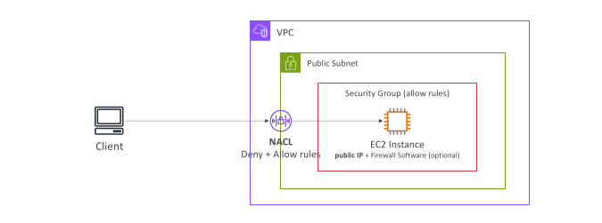
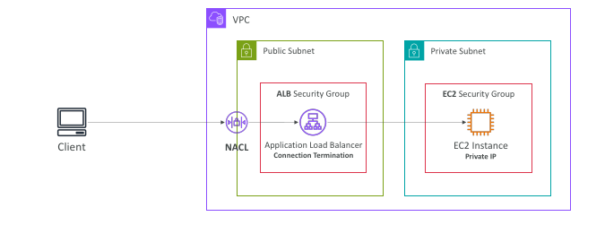
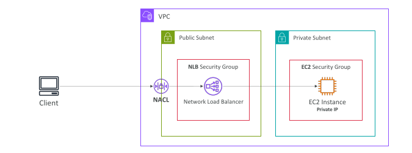
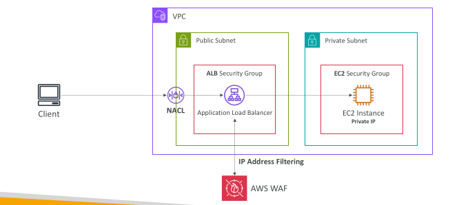
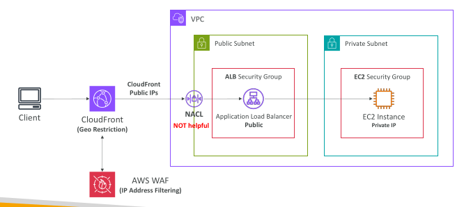

## Blocking an IP address

## Blocking an IP address – with an ALB

## Blocking an IP address – with an NLB

## Blocking an IP address – ALB + WAF

## Blocking an IP address – ALB, CloudFront & WAF

