## VPC Peering

• Privately connect two VPCs using AWS’ network

• Make them behave as if they were in the same network

• Must not have overlapping CIDRs

• VPC Peering connection is NOT transitive (must be established for each VPC that need to communicate with one another)

• You must update route tables in each VPC’s subnets to ensure EC2 instances can communicate with each other

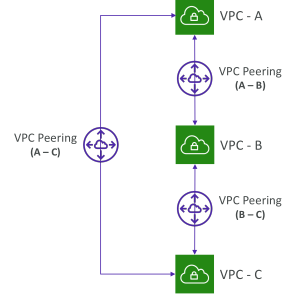

## VPC Peering – Good to know

• You can create VPC Peering connection between VPCs in different AWS accounts/regions

• You can reference a security group in a peered VPC (works cross accounts – same region)

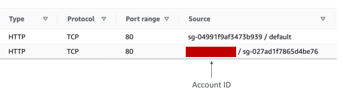

## VPC Peering

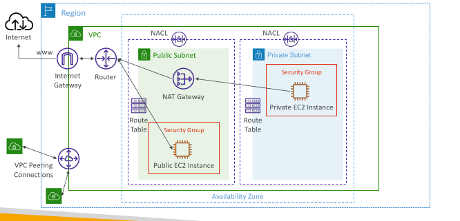

## VPC Endpoints

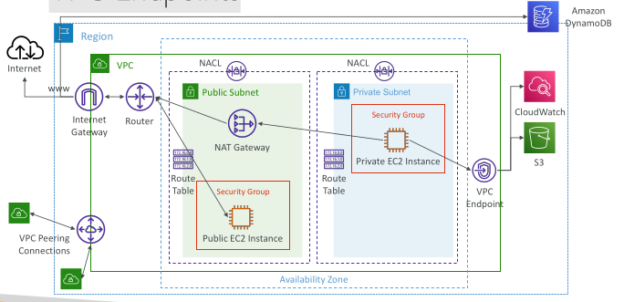

## VPC Endpoints (AWS PrivateLink)

Every AWS service is publicly exposed (public URL)

VPC Endpoints (powered by AWS PrivateLink) allows you to connect to AWS services using a private network instead of using the public Internet

They’re redundant and scale horizontally

They remove the need of IGW, NATGW, … to access AWS Services

In case of issues:
 - Check DNS Setting Resolution in your VPC
 - Check Route Tables

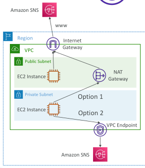

## Types of Endpoints

Interface Endpoints (powered by PrivateLink)
 - Provisions an ENI (private IP address) as an entry point (must attach a Security Group)
 - Supports most AWS services
 - $ per hour + $ per GB of data processed

Gateway Endpoints
 - Provisions a gateway and must be used as a target in a route table (does not use security groups)
 - Supports both S3 and DynamoDB
 - Free

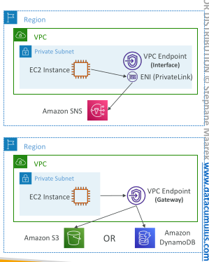

## Gateway or Interface Endpoint for S3?

• Gateway is most likely going to be preferred all the time at the exam

• Cost: free for Gateway, $ for interface endpoint

• Interface Endpoint is preferred access is required from on-premises (Site to Site VPN or Direct Connect), a different VPC or a different region

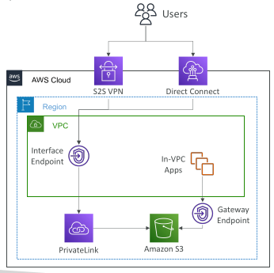

## Lambda in VPC accessing DynamoDB

DynamoDB is a public service from AWS

Option 1: Access from the public internet
 - Because Lambda is in a VPC, it needs a NAT Gateway in a public subnet and an internet gateway

Option 2 (better & free): Access from the private VPC network
 - Deploy a VPC Gateway endpointfor DynamoDB
 - Change the Route Tables

 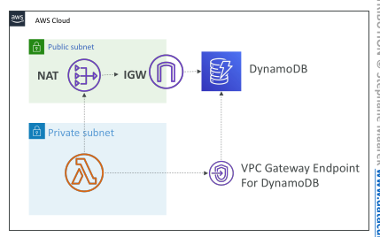

 ## VPC Flow Logs

Capture information about IP traffic going into your interfaces:
 - VPC Flow Logs
 - Subnet Flow Logs
 - Elastic Network Interface (ENI) Flow Logs

Helps to monitor & troubleshoot connectivity issues

Flow logs data can go to S3, CloudWatch Logs, and Kinesis Data Firehose

Captures network information from AWS managed interfaces too: ELB, RDS, ElastiCache, Redshift, WorkSpaces, NATGW, Transit Gateway…

## VPC Flow Logs

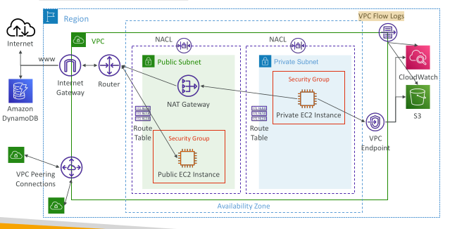

## VPC Flow Logs Syntax

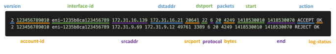

• srcaddr & dstaddr – help identify problematic IP

• srcport & dstport – help identity problematic ports

• Action – success or failure of the request due to Security Group / NACL

• Can be used for analytics on usage patterns, or malicious behavior

• Query VPC flow logs using Athena on S3 or CloudWatch Logs Insights

• Flow Logs examples: https://docs.aws.amazon.com/vpc/latest/userguide/flow-logs-
records-examples.html

## VPC Flow Logs – Troubleshoot SG & NACL issues

Look at the “ACTION” field

Incoming Requests
 - Inbound REJECT => NACL or SG - Outbound REJECT => NACL or SG
 - Inbound ACCEPT, 

Outgoing Requests
 - Outbound REJECT => NACL
 - Outbound ACCEPT, Inbound REJECT => NACL

 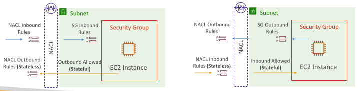

## VPC Flow Logs – Architectures

## VPC Flow Logs – CloudWatch Permissions

• IAM Service Role associated with VPC Flow Logs must have the required permissions to publish logs to CloudWatch Logs

• logs:CreateLogGroup, logs:CreateLogStream, or logs:PutLogEvents

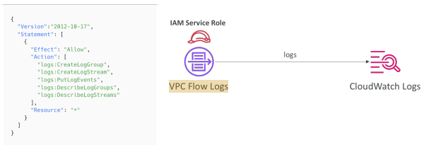

## AWS Site-to-Site VPN

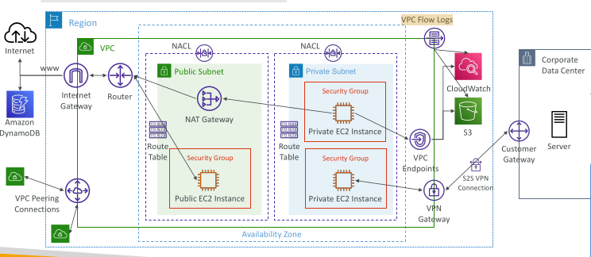

## AWS Site-to-Site VPN

Virtual Private Gateway (VGW)
 - VPN concentrator on the AWS side of the VPN connection
 - VGW is created and attached to the VPC from which you want to create the Site-to-Site VPN connection
 - Possibility to customize the ASN (Autonomous System Number)

Customer Gateway (CGW)
 - Software application or physical device on customer side of the VPN connection
 - https://docs.aws.amazon.com/vpn/latest/s2svpn/your-cgw.html#DevicesTested

## Site-to-Site VPN Connections - EXAM important

Customer Gateway Device (On-premises) Security Group
 - What IP address to use?
   - Public Internet-routable IP address for your Customer Gateway device
   - If it’s behind a NAT device that’s enabled for NAT traversal (NAT-T), use the public IP address of the NAT device

Important step: enable Route Propagation for the Virtual Private Gateway in the route table that is associated with your subnets

If you need to ping your EC2 instances from on-premises, make sure you add the ICMP protocol on the inbound of your security groups

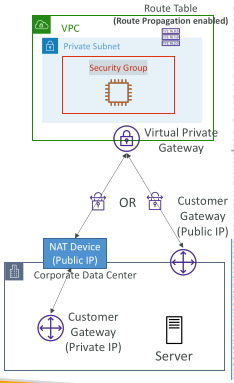

## AWS VPN CloudHub

• Provide secure communication between multiple sites, if you have multiple VPN connections 

Availability Zone

• Low-cost hub-and-spoke model for primary or secondary network connectivity between different locations (VPN only)

• It’s a VPN connection so it goes over the public Internet

• To set it up, connect multiple VPN connections on the same VGW, setup dynamic routing and configure route tables

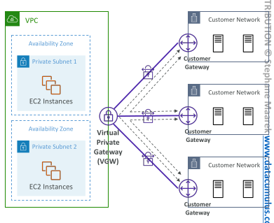

## Direct Connect (DX)

Provides a dedicated private connection from a remote network to your VPC

Dedicated connection must be setup between your DC and AWS Direct Connect locations

You need to setup a Virtual Private Gateway on your VPC

Access public resources (S3) and private (EC2) on same connection

Use Cases:
 - Increase bandwidth throughput - working with large data sets – lower cost
 - More consistent network experience - applications using real-time data feeds
 - Hybrid Environments (on prem + cloud)

Supports both IPv4 and IPv6

## Direct Connect Diagram

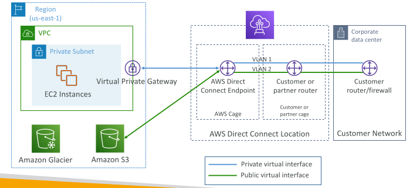

## Direct Connect Gateway

• If you want to setup a Direct Connect to one or more VPC in many different regions (same account), you must use a Direct Connect Gateway

## Direct Connect – Connection Types - EXAM important

Dedicated Connections: from 1 Gbps to 400 Gbps
 - Physical ethernet port dedicated to a customer
 - Request made to AWS first, then completed by AWS Direct Connect Partners

Hosted Connections: from 50Mbps to 25 Gbps
 - Connection requests are made via AWS Direct Connect Partners
 - Capacity can be added or removed on demand

Lead times are often longer than 1 month to establish a new connection

## Direct Connect – Encryption

• Data in transit is not encrypted but is private

• AWS Direct Connect + VPN provides an IPsec-encrypted private connection

• Good for an extra level of security, but slightly more complex to put in place

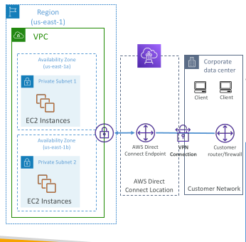

## Direct Connect - Resiliency - EXAM important

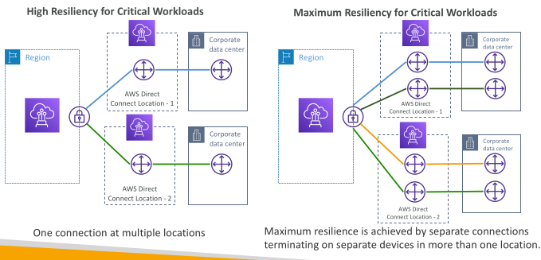

## Site-to-Site VPN connection as a backup - Exam important

• In case Direct Connect fails, you can set up a backup Direct Connect connection (expensive), or a Site-to-Site VPN connection

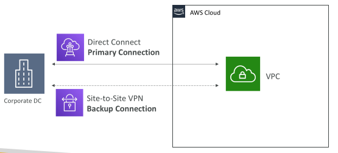

## Network topologies can become complicated

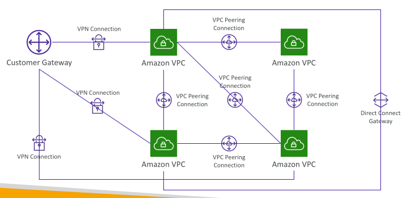

## Transit Gateway

For having transitive peering between thousands of VPC and on-premises, hub-and-spoke (star) connection

Regional resource, can work cross-region

Share cross-account using Resource Access Manager (RAM)

You can peer Transit Gateways across regions

Route Tables: limit which VPC can talk with other VPC Amazon VPC

Works with Direct Connect Gateway, VPN connections

Supports IP Multicast (not supported by any other AWS service) - EXAM IMPORTANT

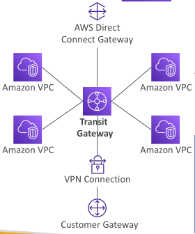

## Transit Gateway: Site-to-Site VPN ECMP - EXAM IMPORTANT

• ECMP = Equal-cost multi-path routing

• Routing strategy to allow to forward a packet over multiple best path

• Use case: create multiple Site-to-Site VPN connections to increase the bandwidth of your connection to AWS

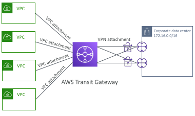

## Transit Gateway: throughput with ECMP - exam important

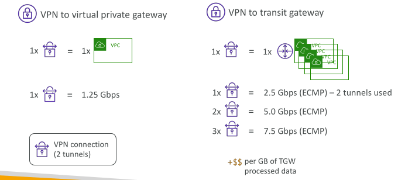

## Transit Gateway – Share Direct Connect between multiple accounts

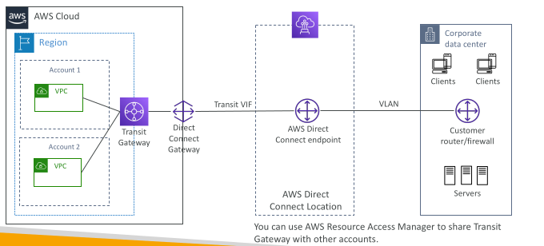

## VPC – Traffic Mirroring

Allows you to capture and inspect network traffic in your VPC

Route the traffic to security appliances that you manage

Capture the traffic
 - From (Source) – ENIs
 - To (Targets) – an ENI or a Network Load Balancer

Capture all packets or capture the packets of your interest (optionally, truncate packets)

Source and Target can be in the same VPC or different VPCs (VPC Peering)

Use cases: content inspection, threat monitoring, troubleshooting, …

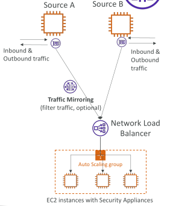

## What is IPv6?

IPv4 designed to provide 4.3 Billion addresses (they’ll be exhausted soon)

IPv6 is the successor of IPv4

IPv6 is designed to provide 3.4 × 10,- unique IP addresses

Every IPv6 address in AWS is public and Internet-routable (no private range)

Format -> x.x.x.x.x.x.x.x (x is hexadecimal, range can be from 0000 to ffff)

Examples:
 - 2001:db8:3333:4444:5555:6666:7777:8888
 - 2001:db8:3333:4444:cccc:dddd:eeee:ffff
 - :: è all 8 segments are zero
 - 2001:db8:: è the last 6 segments are zero
 - ::1234:5678 è the first 6 segments are zero
 - 2001:db8::1234:5678 è the middle 4 segments are zero

## IPv6 in VPC

• IPv4 cannot be disabled for your VPC and subnets

• You can enable IPv6 (they’re public IP addresses) to operate in dual-stack mode

• Your EC2 instances will get at least a private internal IPv4 and a public IPv6

• They can communicate using either IPv4 or IPv6 to the internet through an Internet Gateway

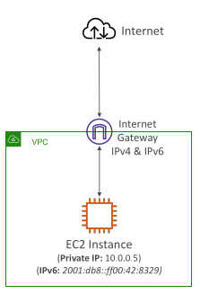

## IPv4 Troubleshooting

IPv4 cannot be disabled for your VPC and subnets

So, if you cannot launch an EC2 instance in your subnet
 - It’s not because it cannot acquire an IPv6 (the space is very large)
 - It’s because there are no available IPv4 in your subnet

Solution: create a new IPv4 CIDR in your subnet

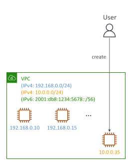

## Egress-only Internet Gateway

• Used for IPv6 only

• (similar to a NAT Gateway but for IPv6)

• Allows instances in your VPC outbound connections over IPv6 while preventing the internet to initiate an IPv6 connection to your instances

• You must update the Route Tables

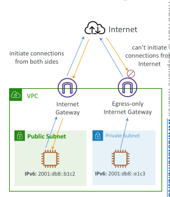

## IPv6 Routing

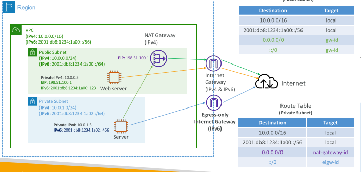

## VPC Section Summary (1/3)

• CIDR – IP Range

• VPC – Virtual Private Cloud => we define a list of IPv4 & IPv6 CIDR

• Subnets – tied to an AZ, we define a CIDR

• Internet Gateway – at the VPC level, provide IPv4 & IPv6 Internet Access

• Route Tables – must be edited to add routes from subnets to the IGW, VPC Peering Connections, VPC Endpoints, …

• Bastion Host – public EC2 instance to SSH into, that has SSH connectivity to EC2 instances in private subnets

• NAT Instances – gives Internet access to EC2 instances in private subnets. Old, must be setup in a public subnet, disable Source / Destination check flag

• NAT Gateway – managed by AWS, provides scalable Internet access to private EC2 instances, when the target is an IPv4 address

## VPC Section Summary (2/3)

• NACL – stateless, subnet rules for inbound and outbound, don’t forget Ephemeral Ports

• Security Groups – stateful, operate at the EC2 instance level

• VPC Peering – connect two VPCs with non overlapping CIDR, non-transitive

• VPC Endpoints – provide private access to AWS Services (S3, DynamoDB, CloudFormation, SSM) within a VPC

• VPC Flow Logs – can be setup at the VPC / Subnet / ENI Level, for ACCEPT and REJECT traffic, helps identifying attacks, analyze using Athena or CloudWatch Logs Insights

• Site-to-Site VPN – setup a Customer Gateway on DC, a Virtual Private Gateway on VPC, and site-to-site VPN over public Internet

• AWS VPN CloudHub – hub-and-spoke VPN model to connect your sites

## VPC Section Summary (3/3)

Direct Connect – setup a Virtual Private Gateway on VPC, and establish a direct private connection to an AWS Direct Connect Location

Direct Connect Gateway – setup a Direct Connect to many VPCs in different AWS regions

AWS PrivateLink / VPC Endpoint Services:
 - Connect services privately from your service VPC to customers VPC
 - Doesn’t need VPC Peering, public Internet, NAT Gateway, Route Tables
 - Must be used with Network Load Balancer & ENI

ClassicLink – connect EC2-Classic EC2 instances privately to your VPC

Transit Gateway – transitive peering connections for VPC, VPN & DX

Traffic Mirroring – copy network traffic from ENIs for further analysis

Egress-only Internet Gateway – like a NAT Gateway, but for IPv6 targets

## Networking Costs in AWS per GB - Simplified

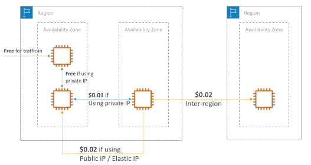

• Use Private IP instead of Public IP for good savings and better network performance

• Use same AZ for maximum savings (at the cost of high availability)

## Minimizing egress traffic network cost

• Egress traffic: outbound traffic (from AWS to outside)

• Ingress traffic: inbound traffic - from outside to AWS (typically free)

• Try to keep as much internet traffic within AWS to minimize costs

• Direct Connect location that are co-located in the same AWS Region result in lower cost for egress network

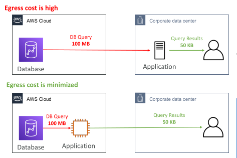

## S3 Data Transfer Pricing – Analysis for USA

S3 ingress: free

S3 to Internet: $0.09 per GB

S3 Transfer Acceleration:
 - Faster transfer times (50 to 500% better)
 - Additional cost on top of Data Transfer Pricing: +$0.04 to $0.08 per GB

S3 to CloudFront: $0.00 per GB

CloudFront to Internet: $0.085 per GB (slightly cheaper than S3)
 - Caching capability (lower latency)
 - Reduce costs associated with S3 Requests Pricing (7x cheaper with CloudFront)

S3 Cross Region Replication: $0.02 per GB

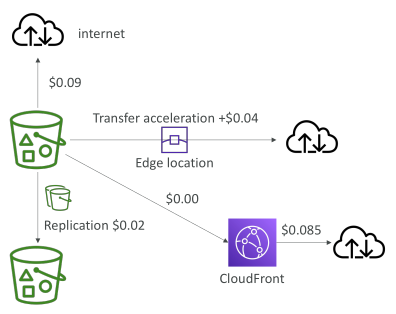

## Pricing: NAT Gateway vs Gateway VPC Endpoint

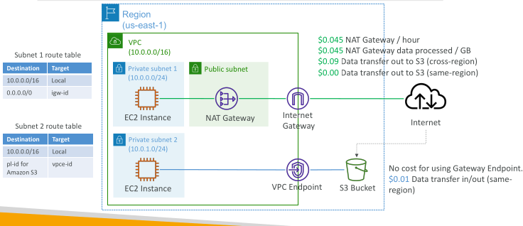

## Network Protection on AWS

To protect network on AWS, we’ve seen
 - Network Access Control Lists (NACLs)
 - Amazon VPC security groups
 - AWS WAF (protect against malicious requests)
 - AWS Shield & AWS Shield Advanced
 - AWS Firewall Manager (to manage them across accounts)

But what if we want to protect in a sophisticated way our entire VPC?

## AWS Network Firewall

• Protect your entire Amazon VPC

From Layer 3 to Layer 7 protection

Any direction, you can inspect
 - VPC to VPC traffic
 - Outbound to internet
 - Inbound from internet
 - To / from Direct Connect & Site-to-Site VPN

• Internally, the AWS Network Firewall uses the AWS Gateway Load Balancer
• Rules can be centrally managed cross-account by AWS Firewall Manager to apply to many VPCs

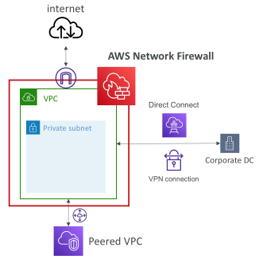

## Network Firewall – Fine Grained Controls

Supports 1000s of rules
 - IP & port - example: 10,000s of IPs filtering
 - Protocol – example: block the SMB protocol for outbound communications
 - Stateful domain list rule groups: only allow outbound traffic to *.mycorp.com or third-party software repo
 - General pattern matching using regex

Traffic filtering: Allow, drop, or alert for the traffic that matches the rules

Active flow inspection to protect against network threats with intrusion-prevention
capabilities (like Gateway Load Balancer, but all managed by AWS)

Send logs of rule matches to Amazon S3, CloudWatch Logs, Kinesis Data Firehose